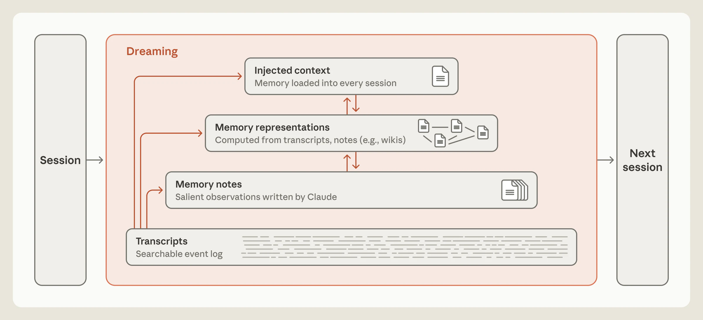
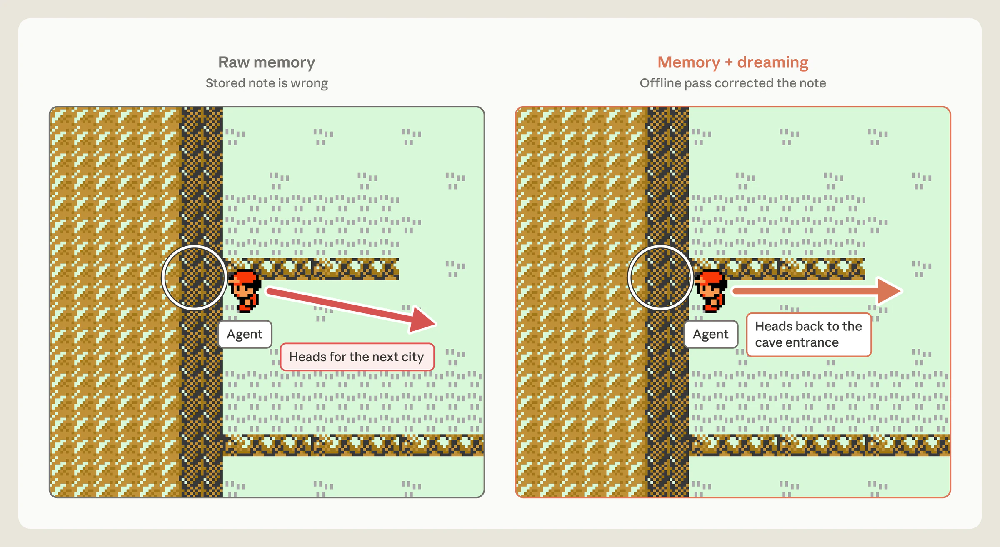
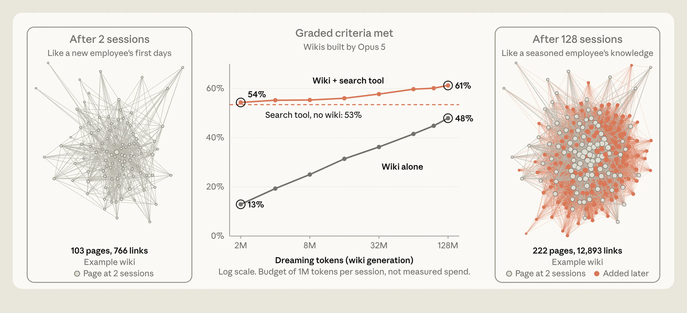
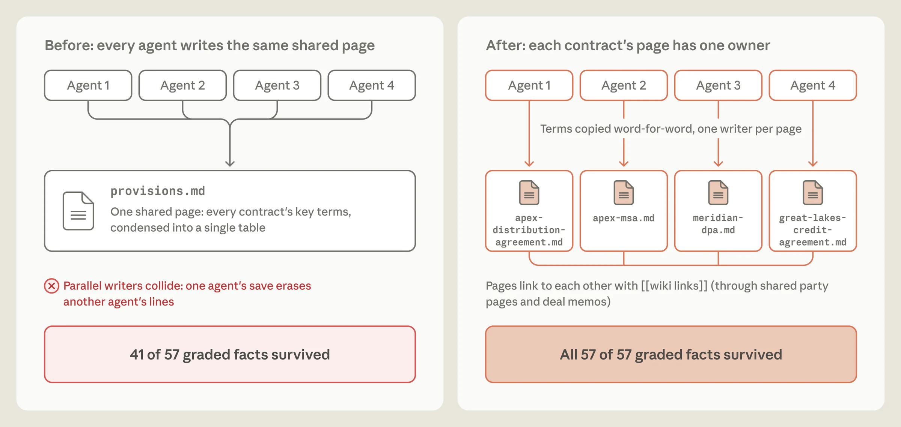
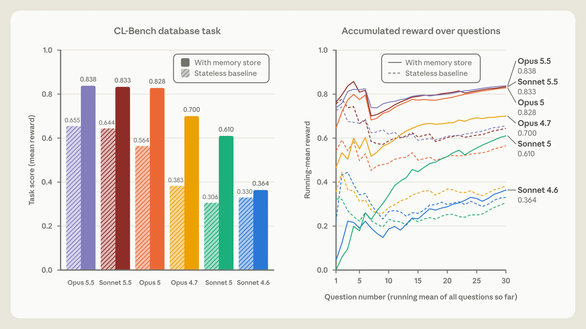
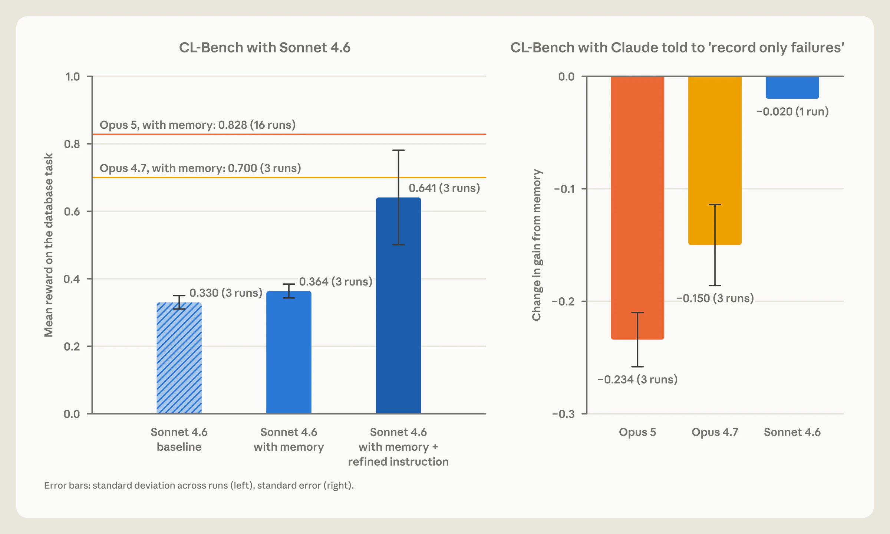
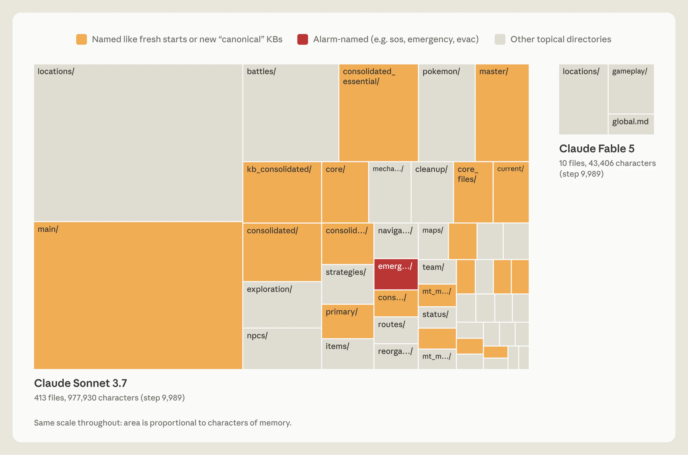
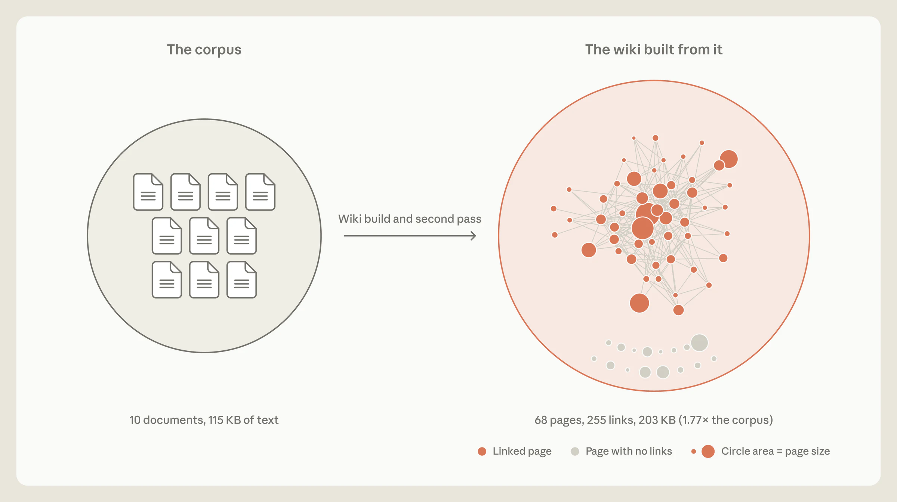

# Anthropic《The components of agent memory》精讲

> 原文：https://www.anthropic.com/research/components-of-agent-memory
> 发布：2026-11-06，作者 Lance Martin（编辑：Caitlin Love / Tom Chivers 等）
> 定位：目前对 agent memory 最系统的一份"工程拆解"——不是记忆产品功能介绍，而是把 memory 拆成**四个可分别实现、分别失效的层**，外加一个**离线搬运工**（dreaming）。

---

## 0. 一句话结论

**记忆不是"把 transcript 存下来"，而是"在四层之间搬运货物"：底层真实但难用，顶层好用但极易写错。Dreaming 是那个在你睡觉时搬运、校对、并决定哪句话能被放进每次对话开头的工人。**

---

## 1. 问题：两个失败同时发生

Kierkegaard：生活只能倒着理解，却必须正着过。记忆设计撞的是同一个墙——**你写下一条记忆的那一刻，无法知道它将来是否有用**。

| 失败 | 表现 | 常见"解法"的代价 |
|---|---|---|
| **遗忘（forgetting）** | 每次 session 从零开始，上周的决策、踩过的坑、验证过的规则全没了 | — |
| **膨胀（swelling）** | 为了不忘，把历史全塞进 context | 注意力被稀释、成本上升、过期事实和新事实互相打架 |

两个失败是一起来的：你为了治 A 就制造 B。所以必须分层，而不是"存更多"。

---

## 2. 定义边界（很重要，避免误用）

文章把 **agent memory** 严格定义为：**Claude 从经验中获得、跨 session 保留、并且能作为 context 读回来的知识**。

明确排除三样东西：

- **权重更新**（训练/微调）——不在讨论范围
- **in-context learning**（单次对话内的学习）——不算，因为它跨不了 session
- **compaction**（压缩：用摘要替换旧轮次，好让工作在新窗口继续）——那是"同一个 session 的续命"，不是记忆

> 工程含义：**如果你把 compaction 当 memory 来做，你得到的是一个会失真的摘要链，而不是可审计的知识库。**

---

## 3. 四层记忆栈

```
┌─────────────────────────────────────────────┐
│ L4 注入上下文 injected context                │  ← 每个 session 开头自动加载
│    约束：必须小（Claude Code 只读 MEMORY.md   │
│    前 200 行 / 25KB，作为"索引"）              │
├─────────────────────────────────────────────┤
│ L3 记忆表征 representations（wiki）           │  ← 页面 + 链接 = 一张地图
│    约束：会膨胀，可能比源文件还大              │
├─────────────────────────────────────────────┤
│ L2 记忆笔记 memory notes                      │  ← 模型在工作时判断"这值得记"
│    约束：靠的是判断力，不是硬规则              │
├─────────────────────────────────────────────┤
│ L1 逐字记录 transcripts                       │  ← 系统自动写，不可编辑
│    约束：唯一的 ground truth；上层全靠它校对   │
└─────────────────────────────────────────────┘
        ▲                    ▲
        └──── Dreaming ──────┘  离线跑，可向上搬运任意层
```


| 层 | 是什么 | 谁写 | 决定性约束 |
|---|---|---|---|
| **L1 Transcripts** | session 记录、日志 | 系统自动 | 唯一不可篡改的事实源；dreaming 用它校对上面所有层 |
| **L2 Notes** | 规则、已验证事实、踩过的坑 | 模型边干边判断 | **判断力 > 固定规则**（见 §5） |
| **L3 Representations（wiki）** | 页面 + 互链，相当于"记忆的地图" | dreaming 离线 | 会膨胀，可能大到不抽象任何东西 |
| **L4 Injected context** | 每次 session 开头预加载 | harness + dreaming 的"晋升" | 必须保持很小；长指令文件反而降低遵从率 |

**为什么顶层必须小？** 三个叠加原因：
1. 注入的记忆直接吃 token；
2. 一条错误笔记会被带进**每一个** session；
3. Anthropic 自己的文档警告：**指令文件越长，遵从率越低**。所以 dreaming 在顶层的主要工作其实是"**把细节往下推，只留链接**"。

**Claude Code 的现成实现**：auto memory 不把所有记忆塞进 context，只加载 `MEMORY.md` 的前 200 行 / 25KB —— 这个头部是一个**索引**（我知道什么、在哪找），不是一个知识库。

---

## 4. Dreaming：离线做的五件事

理论来源：Letta & UC Berkeley 的 **sleep-time compute**（arXiv 2504.13171）——在交互间隙用闲置算力重整已有 context。生物学类比：海马体在睡眠中回放近期经验，逐步蒸馏进新皮层。

### 4.1 纠错（correct）

**案例：Pokémon 的月见山陷阱。** 洞穴入口在西、出口在东，入口附近有个单向台阶会把你摔回原路。Claude 用入口旁的 PokéCenter 当地标，却（错误地）记成"PokéCenter 在东侧"，走出门就宣布"Mt Moon 已经过了"，几步后掉下台阶；导航工具没显示掉落，于是它推断"我走过头往西了"，其实一直在错的一侧。

- **无纠错**：掉了三次台阶，写下"我不想再循环，我停下了"，最终退回 Pewter City，**从未到 Cerulean**。
- **dreaming 校对**：拿笔记和 transcript 对照，抓出错误并重写 → Claude 说"现在我要找月见山入口重新进去" → **在第 1,935 步到达 Cerulean**。
- **无记忆**：同样到不了。

> 关键洞察：**transcript 给了 memory 一个可以校验的 ground truth。没有它，"纠错"就退化成两个摘要互相点头。**

### 4.2 建表征（represent）

**实验：Stainless 语料**（Anthropic 2026-05 收购的公司）——约 **35 万个文件、约 4.2 亿 token**。25 道题，给一个搜索工具，再让 Opus 5 agent 用 dreaming 建 wiki（128 个 session，写/改/合并重复/对源文件核验主张）。

| 配置 | 分数 |
|---|---|
| 纯 search | 53%（不随 wiki 增长而变） |
| 纯 wiki 答题 | 13% → **48%**（随 dreaming 从 2 session 扩到 128） |
| **wiki + search** | 54% → **61%**，且**每题省约 20,000 token** |

wiki 规模：2 个 session 后 103 页 / 766 条链接；128 个 session 后 222 页 / 12,893 条链接。

> 类比：早期 dreaming 像新员工，只能靠 wiki 答；dreaming 越多，地图越像老员工脑子里的那张。

### 4.3 晋升（promote）
把少数"每个 session 都该有"的笔记抬到 L4，让 Claude 不必搜索、甚至不必知道有东西可搜。
**代价对称地清楚**：吃 token + 一条错笔记污染所有 session。所以晋升要当**发布流程**来做。

### 4.4 聚焦（focus）

同样语料 + 不同指令 = 不同 wiki。**合同审查任务**的教训最硬：

- 初版指令没告诉 Claude"合同条款是最重要的"，几个 agent 同时往一张共享的 `provisions.md` 写，互相覆盖 → 简报只覆盖 **41/57 个受评事实（72%）**。
- 然后跑一个**反思循环**：Claude 反思失败 → 提出修改"怎么建 wiki"的指令 → 重建 wiki。它自己发现了"条款必须逐字引用"这件事。
- 改法：**一份合同一页、一页一个 agent、条款逐字引用**（不是摘要成共享表）→ **57/57（100%）**。

### 4.5 补漏（fill gaps）
单 session 只能看见自己的 context；dreaming 能跨 session 找共性、补缺口。
**案例**：wiki 里有 9 条链接指向不存在的 `escrow-agreement` 页。第二轮 dreaming 把它们重指到已存在的 `buyer-form-escrow-agreement`，并新增 3 页（含一个 index）。规模 38 页/225 链接 → 41 页/278 链接。

---

## 5. 关键数字：CL-Bench 1.0（学习闭环）


任务：连续回答数据库查询题，每题答完会被告知正确答案，并可写记忆帮助未来。
设置：每题一个全新 session，唯一跨 session 的东西是持久化的 memory 目录（Claude Managed Agents）。

| 模型 | 无记忆 | 有记忆 | 增益 |
|---|---|---|---|
| **Opus 5.5** | 0.655 | **0.838** | +0.183 |
| Sonnet 5.5 | 0.644 | 0.833 | +0.189 |
| Opus 5 | 0.564 | 0.828 | +0.264 |
| Opus 4.7 | 0.383 | 0.700 | +0.317 |
| Sonnet 5 | 0.306 | 0.610 | +0.304 |
| Sonnet 4.6 | 0.330 | 0.364 | +0.034 |

**代际差异不在分数，在"记忆的形状"：**

- **Sonnet 4.6**：一堆散乱的文件，每个里面几条**未验证的猜测**。
- **Opus 4.7**：合并成单一参考文档，开始标记"哪些已核验/未确认"。
- **Sonnet 5**：等 grader 判过才标 confirmed，答错时写 corrections。
- **Opus 5**：**第一个闭上学习闭环**——多数条目含"规则 + 我怎么知道这条规则成立 + 早前问题的答案 + 沿途发现的陷阱警告"。
- **Opus 5.5 / Sonnet 5.5**：同样闭了环，但因基线更高，增益看起来小。

> 注意这个反直觉现象：**更强的模型"从记忆里获得的增益"反而更小**，因为它不带记忆时已经很强。评估 memory 系统时必须同时报 baseline，否则会把"模型变强"误读成"记忆没用"。

---

## 6. 最有价值的反直觉结论：别写硬规则

在 CL-Bench 上，Anthropic 只告诉 Claude "有一个 memory 目录可用"。这一句就够了——Opus 4.7 和 Opus 5 都自己用得很好。

然后他们逐条测试"规定该记什么"，每条规则一个实验。结果：


**规则"只记录失败"（record only failures）让记忆的增益崩掉：**

| 模型 | 增益变化 |
|---|---|
| **Opus 5** | **−0.234** |
| Opus 4.7 | −0.150 |
| Sonnet 4.6 | −0.020 |

**解读（这是全文最实用的一条）**：
- 对**强模型**，把"什么值得记"的判断权交给它，远比预设固定规则有效；硬规则会**削弱**性能。
- 硬规则是**弱模型的拐杖**。Sonnet 4.6 的问题根本不是"记错东西"，而是**根本不读记忆目录**、也**不去验证自己的猜测**。改成提示它"先读记忆再回答，再显式验证你的猜想"后，分数从 0.364 → **0.641**（接近翻倍）。
- Sonnet 5 无需提示，**10 次里有 9 次**会先读记忆；Sonnet 4.6 不到一半。

> 一句话：**告诉模型"记忆是干什么用的"，但不要告诉它"该怎么用"。**

---

## 7. 第二个关键结论：判断力比容量重要（Pokémon 对照）


同一起点、同样步数（约 10,000 步）时的记忆文件夹：

| | Sonnet 3.7 | Fable 5 |
|---|---|---|
| 文件数 | **413 个文件 / 225 个文件夹** | **9 个文件 / 2 个文件夹 + 一个 `global.md`** |
| 字符数 | 977,930 | 43,406 |
| 徽章 | 1 个 | **4 个** |

**Sonnet 3.7 错在哪**：它假设"一切都可能重要"，为每场战斗、每个道具、每个 NPC 各建一个文件。但**游戏状态在持续变化**——它的详尽记录一直在过期。到第 10,000 步左右它开始第四套"master"记忆文件，接下来 17 步里建了 6 个文件、删了 9 个，**游戏里一步没走**。

**Fable 5 对在哪**：它只记**游戏不会告诉你的东西**。
- 屏幕上每回合都能读到的（多少钱、在哪张图）→ 存了是冗余。
- 策略、计划、验证过的规则 → 只有你写下来才存在。

它的记忆结构：
- `global.md` = 仪表盘（当前目标、打道馆的预写计划、它自己使用记忆的规则）
- `locations/` = 具体路线的导航计划
- `gameplay/` = 对游戏机制的策略总结

示例条目（连试 7 个精灵球没抓到最易抓的鲤鱼王后写的）：
> "若连续 3+ 个球失败，就**变换节奏**（在菜单步骤间插入额外的 wait 按键）——这样做的下一次就抓到了。"

Opus 5.5 用类似策略（小文件夹、只跟踪当前目标和下一步、边玩边重写），**通关了**。

---

## 8. 表征不是万灵药（三个反例）


同一套 Harvey LAB 基准 + 并购文件，wiki 的表现分三种情况：

| 情况 | 结论 |
|---|---|
| 24 个问题里过半需**跨文档检索/判断/算术** | wiki **87%** vs 纯 search **73%** ✅ |
| 判据基本都能在**单文档**里文本搜到 | wiki **无增益**（≈search） ❌ |
| wiki 膨胀到**比源文件还大** | 10 个文档 115KB → wiki 68 页/255 链接/**203KB（1.77×）**，等于没抽象 ❌ |

第三条被作者用博尔赫斯《论科学的精确性》里那张"和帝国一样大的地图"来讽刺——**地图画得和领土一样大，就不再是地图了**。

> 判据：**wiki 值得建，当且仅当"必须跨文档综合"是任务的主要成本。** 单文档查找类任务，wiki 是纯开销。

---

## 9. 落成工程：八条可直接抄的规则

1. **先分四层，再写代码。** 不可变的记录（transcript）和可重建的投影（notes / wiki / injected）必须物理分开。做不到就先加存储层，别急着换模型。
2. **注入层必须小成一个索引。** 200 行 / 25KB 是可参考的量级：我知道什么、去哪找、往下指的链接。
3. **说清用途，别规定写法。** "有一个 memory 目录可用"对强模型就够；"只记失败"这种硬规则会直接扣分。
4. **给记忆一个可校验的对象。** dreaming 能纠错，前提是 transcript 还在且不可编辑。
5. **把"晋升到注入层"当成发布流程。** 一条错笔记进的是每一个 session。
6. **给 wiki 设预算。** 页数、体积要封顶；或者按访问频次决定花多少维护算力。
7. **算清楚 dreaming 的账。** 它按轮次计费；应聚焦在**易变信息**上，或按访问频次调节节奏（不要指望"检查全部记忆"可行）。
8. **防止多 agent 写冲突。** 合同任务的失败是具体可复现的：多 agent 编辑同一页 → 互相覆盖。**一份文档一页、一页一个 writer、原文逐字引用** → 72% 变 100%。

---

## 10. 权衡与坑（原文自己留的开放问题）

| 问题 | 原文态度 |
|---|---|
| **什么时候写记忆？在线 vs 离线** | 在线写：捕捉得到当下显著性，但**会分走当前任务的注意力**；离线写（dreaming）：不打扰任务，但**产出对当前 session 不可见** |
| **怎么保证记忆不过期** | 会让模型"持续检查全部记忆"不现实。应聚焦易变信息，或按访问频次调 dreaming 节奏 |
| **transcript 搜索能不能当底座？** | "合理"。表征 + 搜索的组合确实有效，但维护表征要算力，且要防止错误和幻觉在表征里累积 |
| **模型能自己判断显著性吗？** | 进步很大，但**没有模型能知道下一轮会发生什么**——这是原理性上限，不是工程缺陷 |

**社区侧的两个主要质疑（HN 187 点 / 103 评论）：**
- **"markdown 技巧不是真记忆"**：不更新权重，AI 永远是《记忆碎片》的主角配一个超优化文件柜。反方：文件形态的记忆**可审计、可删、可迁移**，一条错误结论能被"猎杀并销毁"，埋进权重就只能等下一个版本。
- **"自动记忆多数是噪音"**：多位工程实践者表示已关闭自动记忆，手动删掉 95% 的条目——因为模型写的多数只对当下那个任务有用。他们想要的改进不是"记得更多"，而是**更好的"该不该记"判断**与**作用域（scope）**——这一条恰好是图 3/图 4 想证明"已经进步"的点。

---

## 11. 相关资源

- 原文：https://www.anthropic.com/research/components-of-agent-memory
- sleep-time compute（Letta & UC Berkeley）：https://arxiv.org/abs/2504.13171
- CL-Bench 1.0：https://continual-learning-bench.com/news/cl-bench-1-0/
- Claude Code memory 文档：https://code.claude.com/docs/en/memory
- Dreaming cookbook：https://platform.claude.com/cookbook/managed-agents-cma-dreaming-with-a-dynamic-workflow
- Knowledge wiki 示例：https://github.com/anthropics/claude-quickstarts/tree/main/managed-agents/knowledge-wiki
- 二手精读（四层栈视角）：https://icorer.com/icorer_blog/en/posts/ai/agent-memory-stack/

## 12. 本地配套文件

| 文件 | 内容 |
|---|---|
| `Anthropic-Agent-Memory-全文翻译-2026-11-06.md` | 原文逐段中文翻译，15 张图全部按原文位置内嵌 |
| `Anthropic-Agent-Memory-图片/` | 15 张官方配图原始分辨率（3840px 宽），约 6.3 MB |
| `Anthropic-Agent-Memory-图片/README.md` | 图片清单（尺寸、内容、原文位置）+ CDN 映射与重下命令 |
| `Anthropic-Agent-Memory-图片/list.txt` | 「本地文件名 ↔ CDN 文件名」映射表 |
