# 《The components of agent memory》全文翻译

> 原文：The components of agent memory · Anthropic Research · 2026-11-06
> 作者：Lance Martin（编辑指导：Caitlin Love、Tom Chivers、Rebecca Hiscott、Jake Eaton、Blake Wilson）
> 原文链接：https://www.anthropic.com/research/components-of-agent-memory
> 说明：逐段直译，保持原文结构与语气；图表以文字说明形式并入正文对应位置。

---

克尔凯郭尔写过：生活只能倒着被理解，却必须正着去活。我们在设计 AI agent 的记忆系统时，遇到了同样的两难。

作为人类，我们在生活中不断编码记忆。[海马体](https://stanford.edu/~jlmcc/papers/McCMcNaughtonOReilly95.pdf)在其中居于核心地位，它把当下的经历捕捉下来，使记忆得以快速形成、并且立即可用。但只有[部分经历](https://www.science.org/doi/10.1126/science.adk8261?referrer=https%3A%2F%2Fwww.google.com%2F)会被巩固为长期知识。

这种巩固的大部分，似乎发生在我们的大脑"离线"的时候。当我们睡眠时，以及在我们安静[休息](https://www.nature.com/articles/s41467-018-06213-1)时，海马体会回放近期的经历。这被认为会逐步把这些经历[蒸馏并整合](https://www.nature.com/articles/s41593-019-0467-3)进新皮层——也就是大脑中存储我们所认为的"知识"绝大部分的区域。

Agent 的记忆可以采用类似的分工。Agent 会把大量工作记录在日志或逐字记录（transcript）中。Letta 和 UC Berkeley 的研究者提出了 [sleep-time compute（睡眠时间计算）](https://arxiv.org/abs/2504.13171)，让模型利用交互之间的空闲时间来重整它已有的上下文。同样的思路可以帮助 agent 组织记忆——通过反思日志来修正错误，或产出新的笔记与表征。这个过程通常[被称](https://platform.claude.com/docs/en/managed-agents/dreams)[为](https://research.google/blog/the-sleep-framework-a-new-way-for-llms-to-retain-knowledge-in-continual-learning/) ***dreaming（做梦 / 休眠整理）***（图 1）。

我们发现，dreaming 是帮助我们赋予 Claude 有效记忆的一个有用工具。在这篇文章中，我们分享我们是如何思考 agent 记忆的，并逐一走过我们用来探索 agent 记忆的几项评估——包括 dreaming 的使用，以及每个组件对记忆组织各自贡献了什么。

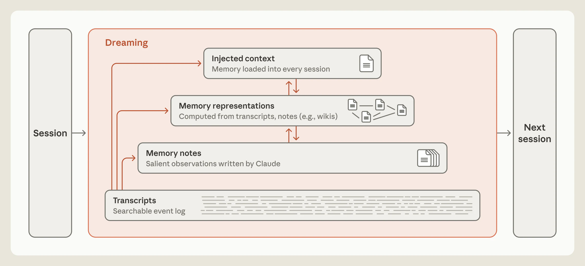

> **图 1**：一个 session 与下一个 session 之间的记忆层级示意。自下而上依次为：transcripts（可搜索的事件日志）、由 Claude 写下的 memory notes（记忆笔记）、memory representations（记忆表征，例如 wiki），以及被加载进每个 session 的 injected context（注入上下文）。在一个标注为 "Dreaming" 的方框内，箭头从 transcripts 指向每一层，并在相邻的上层各层之间双向连接。
>
> 说明：Claude 可以用 dreaming 来组织记忆。它可以修正错误、创建笔记、构建新的记忆表征，或者塑造哪些内容会被预先加载进未来的 session。

## 记忆笔记

我们所说的"agent 记忆"，指的是 **Claude 从经验中获得的、并在 session 之间保留、保存为它之后可以读取的上下文的知识**——这里的经验包括与用户的交互以及分配给它的任务。它排除了模型学习或管理上下文的其它方式，比如对其*权重*（训练时设定的内部参数）的改动、[*in-context learning*（上下文内学习，即在单次对话中获得的知识）](https://www.anthropic.com/research/in-context-learning-and-induction-heads)，以及[*compaction*（压缩，即由 Claude 写出的摘要替换掉较早的轮次，好让它能在新的上下文窗口中继续工作）](https://platform.claude.com/docs/en/build-with-claude/compaction)。

在人类大脑中，某段经历之前、之中或之后释放的化学信号会[把一段记忆标记](https://www.nature.com/articles/385533a0)为重要。被标记的记忆在离线时段比未被标记的记忆更容易被回放。这个过程叫做*回放（replay）*，它帮助这些记忆稳定下来并整合进长期记忆。

类似地，Claude 可以在一个 session 的日志中，把显著的事件在发生时打上标记，以便之后更容易找到；也可以[把它们写](https://platform.claude.com/docs/en/agents-and-tools/tool-use/memory-tool)入一个记忆存储，比如一个存放记忆笔记的文件夹（图 2）。但 Claude 在当下、在它还不知道接下来会发生什么之前，如何判断什么才是显著的？

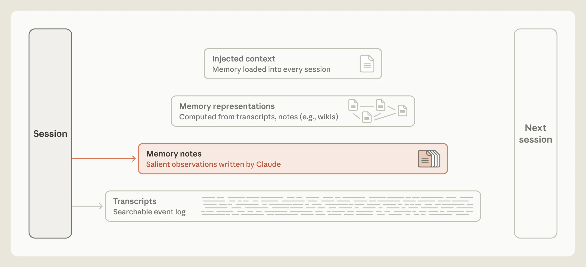

> **图 2**：同一个记忆层级，其中 memory notes 这一层被高亮。一个箭头从 session 直接指向 memory notes，标注为"由 Claude 写下的显著观察"。
>
> 说明：Claude 可以把笔记写入记忆。

## 记忆有时是一种对"未来需要什么"的预测

记忆，偶尔是一种预测。通过写下一条规则，agent 就预测了它正在描述的这个模式将来还会再次相关。比如，写下一条经过验证的事实，就是预测未来某个 session 里的 agent 会希望直接依赖这条事实，而不必再次核对。随着时间推移，Claude 在这类预测上已经变得好得多。

考虑 [Continual Learning Bench（CL-Bench）1.0](https://continual-learning-bench.com/news/cl-bench-1-0/) 中的一项任务——这个基准衡量 agent 利用记忆来处理长程任务的能力。其中一项具体任务要求 Claude 通过查询数据库来回答一系列问题。在 Claude 给出答案后，它会被告知正确答案，并且可以写一条记忆来帮助回答未来的问题。

记忆可以在这里支撑一个学习闭环。如果 Claude 答错了一道题，它可以记录这次失败、提出关于哪里出了错的各种猜想、检验这些猜想，并把发现的东西转化为一条关于将来该如何回答的规则。

我们用 [Claude Managed Agents](https://platform.claude.com/docs/en/managed-agents/overview) 运行了 CL-Bench 1.0 的这项任务。Claude 每道题都在一个全新的 session 中开始，只有一个例外：它可以从一个跨 session 持久存在的[记忆目录](https://platform.claude.com/docs/en/managed-agents/memory)中读取文件。

不同模型在建立自己的学习闭环上达到了不同水平。Claude Sonnet 4.6 最多只做到"提出关于答案为何错误的猜想"这一步。它的记忆目录里散落着一些文件，每个文件都列着几条未经检验的猜测。

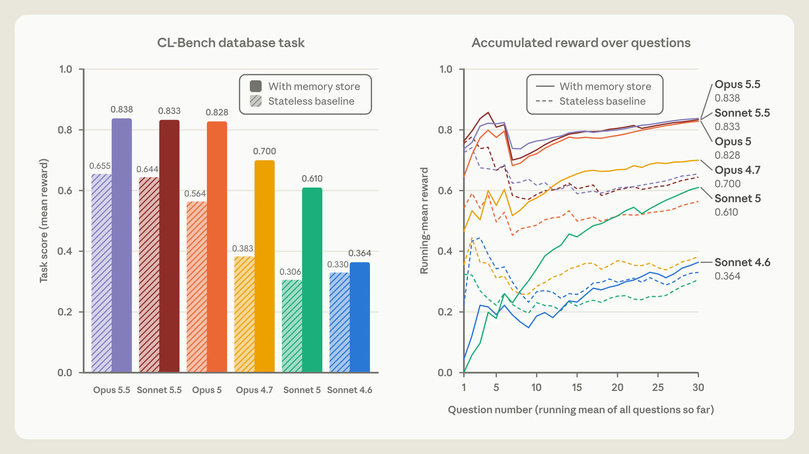

> **图 3**：左图为 CL-Bench 数据库任务的平均奖励柱状图，对比无状态基线与使用记忆存储两种情况。Opus 5.5：0.655 → 0.838。Sonnet 5.5：0.644 → 0.833。Opus 5：0.564 → 0.828。Opus 4.7：0.383 → 0.700。Sonnet 5：0.306 → 0.610。Sonnet 4.6：0.330 → 0.364。右图为同样这些模型在 30 道题上的运行平均奖励折线图，比较有记忆与无记忆两种情况。
>
> 说明：CL-Bench 数据库任务，比较使用记忆与无状态基线在不同模型上的表现。

Claude Opus 4.7 把它的笔记整合成了一份单一的参考文档，并开始标记哪些事实它已核实、哪些尚未确认。Claude Sonnet 5 则在评分器核实过之后才把每个答案标为已确认，并且在答错时写下更正。

Claude Opus 5 是这些模型中第一个真正闭上学习闭环的。它的多数条目都包含一条规则（以及它如何知道这条规则成立）、对更早问题的答案，以及对沿途发现的陷阱的明确警告（图 3）。

与 Opus 5 一样，Claude Opus 5.5 和 Claude Sonnet 5.5 也都闭上了这个闭环，用记忆来捕捉关于"未来如何最好地回答问题"的、经过验证的规则。在使用记忆的情况下，两者的得分与 Opus 5 大致相同，尽管它们在无记忆时的基线表现略高一些。

## Claude 已经学会了判断显著性

我们还评估了 Claude 玩 *Pokémon Red* 的能力——这款游戏会[挑战 Claude 去导航](https://www.youtube.com/watch?v=CXhYDOvgpuU)复杂的长程任务——以此作为对 Claude "该把什么存进记忆"这一*判断*的测试。每次运行开始时，我们给每个模型一个记忆文件夹，它可以在游戏过程中读取和写入（图 4）。

我们比较了 Claude Sonnet 3.7 和 Claude Fable 5 各自在游戏进行到约 10,000 步时的记忆文件夹。我们注意到的一个关键差异是，每个模型认为什么值得记下来。Sonnet 3.7 假设一切都可能重要，于是不加区分地写入记忆。它的记忆文件夹里是一份遭遇存档，往往为它打的每一场战斗、找到的每一件道具、遇到的每一个 NPC 各建一个文件。最终，Sonnet 3.7 在 225 个文件夹中写下了 413 个记忆文件，并拿到了一个徽章（徽章标记玩家在游戏中的进度）。

相比之下，Fable 5 只在两个文件夹里写了九个文件，外加一个名为 `global.md` 的顶层文件，并拿到了四个徽章。

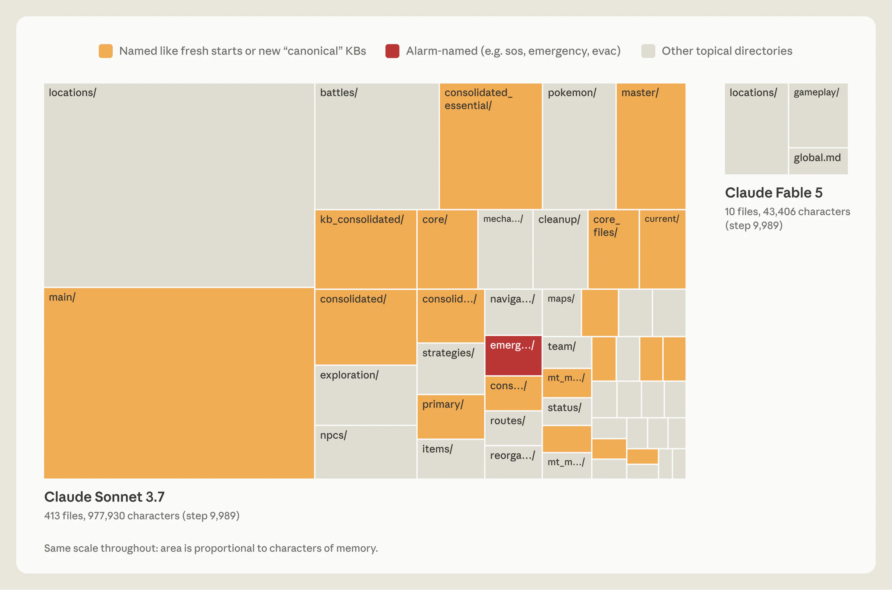

> **图 4**：两张同比例尺的 Pokémon 记忆目录树图（treemap），面积代表记忆的字符量。Claude Sonnet 3.7 的那张又大又拥挤，包含 413 个文件、977,930 个字符，分布在 locations、main、battles 以及几个 "consolidated" 文件夹下。Claude Fable 5 的那张很小，只有 10 个文件、43,406 个字符，分布在 locations、gameplay 和 `global.md` 中。
>
> 说明：Claude 在玩 Pokémon 时，Sonnet 3.7 与 Fable 5 各自的记忆目录。

Sonnet 3.7 的做法之所以有问题，主要是因为 Pokémon 的游戏状态在持续变化——它那份详尽的记录在不断过期。结果就是，随着 Claude 的推进，它不得不花越来越多的时间和资源去翻检自己的记忆，而不是去玩游戏。比如在第 10,000 步附近，Sonnet 3.7 开始建它的第四套"master"记忆文件。在接下来的 17 步里，它创建了六个文件、删除了另外九个，而在游戏本身中一步动作都没做。

Fable 5 的做法则是把记忆用于游戏不会明确告诉它的那些东西。Sonnet 3.7 写进记忆的某些信息——比如玩家有多少钱、玩家在地图上的哪个位置——每一回合都能从屏幕上读到，所以存下来是冗余的。相反，关于策略、计划和已验证规则的那些记忆文件，只有 Claude 自己去想出来才会存在，如果不写下来就会消失。

Fable 5 据此组织了它的记忆。它的 `global.md` 文件充当一块仪表盘，保存当前目标、一份预先写好的攻打道馆（赢得徽章的挑战）的计划，以及模型自己使用记忆的规则。`locations` 文件夹放了在特定路线上导航的计划，`gameplay` 文件夹放了基于它对游戏运作方式的理解而形成的策略。比如，在连续七个精灵球都没能抓到一只鲤鱼王（最容易抓的 Pokémon 之一）之后，Claude 写道："如果连续 3 个以上球失败，就**变换**时机（在菜单步骤之间插入额外的 'wait' 按键）——这样做之后那次就抓到了。"

带着一个小得多的记忆文件夹，Fable 5 在游戏中的推进远远超过 Sonnet 3.7。Opus 5.5 采取了类似的做法：它维护一个小文件夹的记忆笔记，跟踪自己当前的目标和接下来的步骤，并在游戏过程中不断重写它们，最终通关了游戏。

## 引导 Claude 去写记忆

我们发现，告诉 Claude"记忆是干什么用的"是有帮助的，但不要告诉它*如何*使用记忆。在 CL-Bench 上，我们只是告诉 Claude 有一个记忆文件夹可用。这条笼统的指引，就足以让 Opus 4.7 和 Opus 5 有效地使用记忆，并且让两者的表现都有明显提升（图 3）。

我们还测试了给模型关于"应该往记忆里写什么"的具体规则，每条规则对应一个测试。我们把每个模型在每条规则下从记忆中获得的增益，与没有该规则时的增益进行了对比。当我们把规则设为"只记录失败"时，Opus 5 和 Opus 4.7 从记忆中获得的性能提升都大幅缩水（图 5，右）。对更强的模型来说，让它们自由判断显著性比事先设定固定规则更有效，而这些规则可能最终削弱性能。

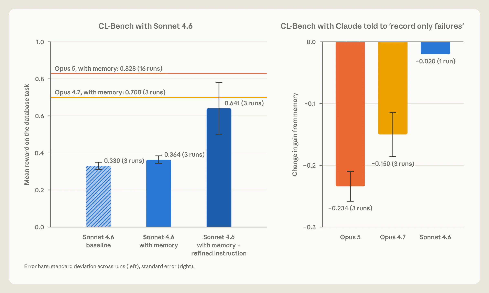

> **图 5**：左图为 Sonnet 4.6 在 CL-Bench 数据库任务上的平均奖励柱状图：基线 0.330，使用记忆 0.364，使用记忆加改进后的指令 0.641。参考线标出 Opus 4.7 使用记忆的 0.700 与 Opus 5 使用记忆的 0.828。右图为被告知"只记录失败"后各模型记忆增益的变化量：Opus 5，−0.234；Opus 4.7，−0.150；Sonnet 4.6，−0.020。
>
> 说明：左：Sonnet 4.6 在 CL-Bench 数据库任务上，有无引导记忆使用的提示词两种情况。右：被告知只记录失败时，各模型从记忆中获得的增益如何变化。

我们还注意到，引导对较老的模型帮助最大。例如，Sonnet 4.6 经常不去读取自己记忆目录中的文件，也没能检验自己关于"答案为何错误"的猜想。

在这种情况下，提示 Claude 在回答前先读取它的记忆文件、然后显式地检验自己的猜想，几乎把它的基准分数翻了一倍（图 5，左）。Sonnet 5 会自己这么做。在没有提示的情况下，它在 10 次中有 9 次会在回答前先读取记忆。相比之下，Sonnet 4.6 这样做的比例不到一半。

对于前沿的 Claude 模型，我们通常只给简单的指引：当有人要求它们创建记忆笔记时，或者当某件事显然值得记住时，就创建记忆笔记；而把这个判断留给 Claude 自己。

## Dreaming 可以修正记忆

由于 Claude 是依据它在 session 内判断为显著的内容来写记忆的，一条从一开始就写错的笔记，或者一条随环境变化而漂移的笔记，可能会被 Claude 在之后的 session 中读到并被信任。

Dreaming 给了 Claude 一种用原始 transcript 来检验其笔记的办法（图 6）。当 Claude 通过 Managed Agents、挂载一个目录作为其记忆来玩 Pokémon 时，我们看到了一个正面的例子。

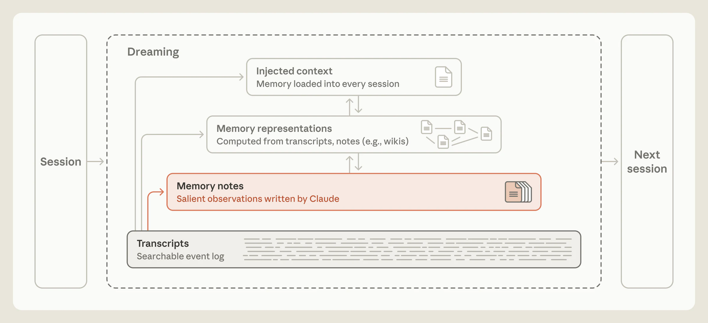

> **图 6**：带 dreaming 的记忆层级，高亮从 transcripts 层指向 memory notes 层的箭头，表示 dreaming 用 transcripts 来修正笔记。
>
> 说明：Dreaming 可以修正记忆中的错误。

在游戏的某一段里，玩家需要穿过月见山（Mt. Moon）——一个入口位于地图西侧、出口位于东侧的洞穴系统。入口附近有一个陷阱：一段单向的台阶，会把玩家摔落到他来的那条路线上，而且没有明显的路能爬回去。Claude 把位于山入口处的 PokéCenter 当作地标，所以它会不会走下那段台阶，取决于它认为 PokéCenter 在山的那一侧。

在某个时刻，Claude（错误地）记下了 PokéCenter 在东侧。当它走出 PokéCenter 时，它宣称"月见山在我身后了"，并更新了笔记："Mt Moon DONE（月见山完成）"。但月见山并不在它身后。几步动作之后，Claude 走过了那段台阶，落回了它来时的那条路线（图 7）。它的导航工具没有显示这次掉落，于是 Claude 得出结论："我往西走过头了"，并且认为自己一直就在正确的一侧。事实并非如此。

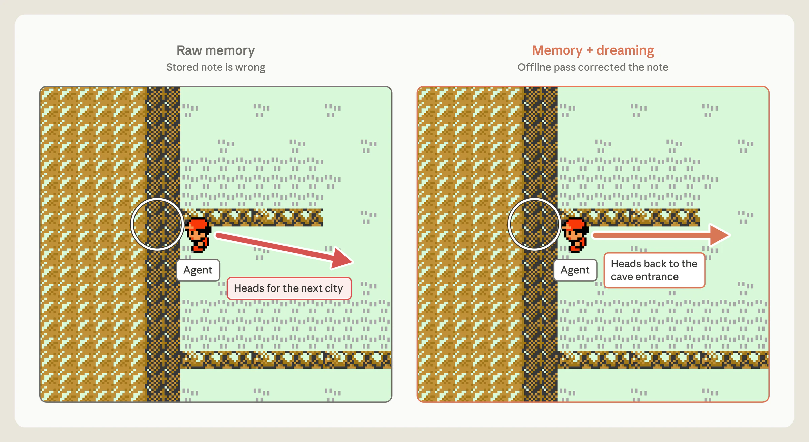

> **图 7**：两张 Pokémon 地图面板，agent 位于台阶旁。左为"原始记忆"，其中存储的笔记是错误的：箭头显示 agent 朝下一个城镇前进。右为"记忆 + dreaming"，其中一次离线处理修正了笔记：箭头显示 agent 返回洞穴入口。
>
> 说明：一条被修正的记忆笔记改变了 Pokémon 中的结果。笔记未修正时，Claude 说"月见山在我身后了"，朝下一个城镇前进，最后又回到了它来时的那条路线。笔记经 dreaming 修正后，它说"现在我需要找到月见山洞口重新进去"，并返回了洞穴。

随后我们测试了 dreaming 能否帮助 Claude 避开这个陷阱。我们针对那个存放着错误 PokéCenter 位置的记忆文件夹运行了 dreaming：Claude 拿这条笔记与 session transcript 对照，抓住了自己的错误并重写了它。transcript 为 Claude 提供了一个可以用来校验其记忆的 ground truth。有了修正后的记忆笔记，Claude 径直返回月见山，最终到达了华蓝市（Cerulean City）。

在笔记未修正的那次运行中，Claude 三次掉回那条更早的路线。第三次失败后，Claude 似乎放弃了，写道："我打算停下来，而不是继续循环。"我们这个环境的自动回复指示它继续。于是它照做了，一路回到了尼比市（Pewter City）——山前面的那个城镇，它希望在那里治疗和补给。那次运行结束时，Claude 始终没有到达华蓝市。

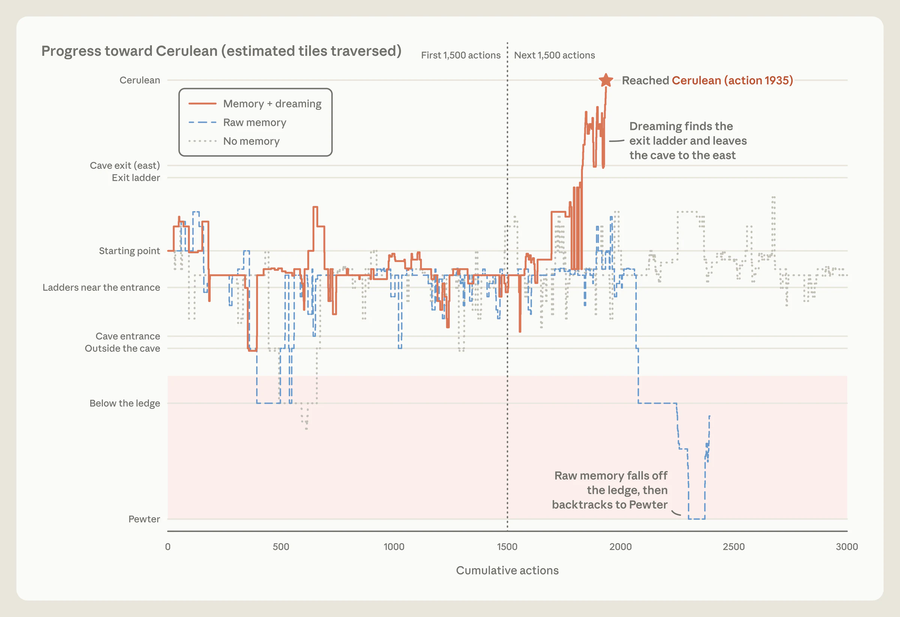

> **图 8**：折线图，显示在累计 3,000 个动作中向华蓝市推进的进度。记忆加 dreaming 的那次运行在第 1,935 个动作时到达华蓝市。原始记忆的那次运行掉下台阶并撤回尼比市。没有记忆的那次运行从未到达华蓝市。
>
> 说明：Dreaming 修正了记忆，Claude 回到洞穴并抵达下一个城镇。使用未修正笔记（"原始记忆"）的那次运行从未越过这座山，无记忆的那次运行也一样。

## Dreaming 可以构建新的记忆表征

借助 dreaming，Claude 可以构建帮助它导航记忆的表征（图 9）。它使用的一类记忆表征叫做 [*wiki*](https://gist.github.com/karpathy/442a6bf555914893e9891c11519de94f)——即由 Claude 撰写和维护的一组页面，汇总 Claude 关于某一主题所知的内容，并把它与其它笔记链接起来。这些链接实际上为 Claude 提供了一张地图，它可以借此筛查自己的记忆，并在需要时高效地定位到相应记忆。

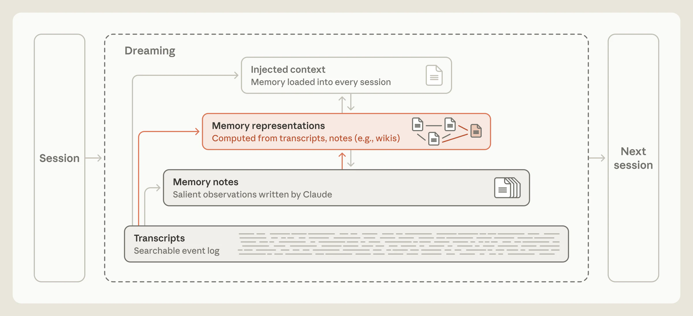

> **图 9**：带 dreaming 的记忆层级，高亮从 transcripts 以及从 memory notes 指向记忆表征层（例如 wiki）的箭头。
>
> 说明：Dreaming 可以构建记忆表征。

像 wiki 这样的表征，可以帮助 Claude 在自己的知识库不断增长时穿行其中。我们用一个内部文档语料探索了 wiki 作为记忆表征的收益——那是 Stainless 的一批文档，约 35 万个文件、大约 4.2 亿 token（Stainless 是我们在五月收购的一家软件公司）。我们围绕这个语料编制了一套 25 道题的评估集，并给 Claude 一个搜索工具去探索它。我们还指示 Claude 用 dreaming 基于这些文件构建一个 wiki。在 128 个 session 中，我们提示 Opus 5 agent 去探索文件、撰写或修正相互链接的 wiki 页面、合并重复内容，并对照来源核验各种主张。

每个 session 都建立在前序 session 中 agent 所取得的进展之上，用一个共享日志来协调工作。当 dreaming 从 2 个 session 扩展到 128 个 session 时，在这 25 道题上的表现从满足 13% 的评分标准增长到 48%（图 10）。

Claude 是逐步构建它的 wiki 的。在创建了初始 wiki 之后，它利用后续轮次的 dreaming 来补充、编辑或删减。在 dreaming 的早期轮次中，Claude 的知识就像一个新员工，仅凭 wiki 来回答问题的能力有限。它做得越多，它的知识地图就越丰富，就像一个经验丰富的老员工。在我们的测试中，我们发现，当我们同时也给 Claude 一个搜索工具时，wiki 对它的帮助最大。当它同时使用搜索和 wiki 时，随着 wiki 的增长，Claude 的综合得分从 54% 升到 61%，而只有搜索工具时则是 53%。当 Claude 仅用 wiki 来回答问题，其最佳得分为 48%。同时使用搜索和 wiki 还让每道题节省了约 20,000 个 token。

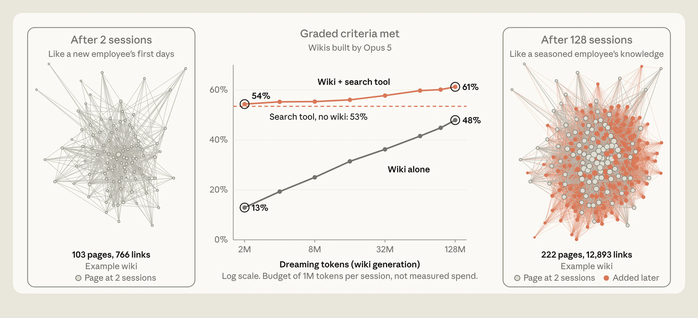

> **图 10**：中间：折线图，显示随着 wiki 生成量从 2M 增长到 128M dreaming token，满足的评分标准比例如何变化。wiki 加搜索工具从 54% 升至 61%，仅 wiki 从 13% 升至 48%，只有搜索工具没有 wiki 时持平在 53%。左、右：一个示例 wiki 的网络图，2 个 session 后为 103 个页面、766 条链接，128 个 session 后为 222 个页面、12,893 条链接。
>
> 说明：中间：在一家公司的文档语料上，随着 Claude 在连续的 session 中构建 wiki，这 25 道题的得分。左、右：一个示例 wiki 分别经历了两个和 128 个 session 后的样子；每个点是一个页面，连线连接互相链接的页面。

我们想测试哪些类型的任务能从 Claude 拥有 wiki 中获益。为此，我们使用了 [Harvey LAB](https://github.com/harveyai/harvey-labs) 基准，以及一批关于一次并购的文档。该基准给 Claude 一组文档，要求 Claude 基于其内容生成一份法律简报。然后，基准会按照一列评分标准对这份简报打分。虽然比玩 Pokémon 少了点趣味，但这些评估为我们提供了多样化的文档集合来构建 wiki。

我们指示 Claude 基于这些文档构建一个 wiki。然后我们要求 Claude 分别从 wiki 和从直接的文件搜索出发，来回答问题（关于那次并购）或生成法律简报（LAB 基准）。其中一个测试问了 24 个关于这次并购的问题（图 11，左），其中超过一半需要 Claude 跨多个文档查找信息，很多还需要 Claude 运用判断力或进行计算。在这些题目上（红色和橙色线条），Claude 查阅 wiki 时得分 87%，而仅用搜索时是 73%。

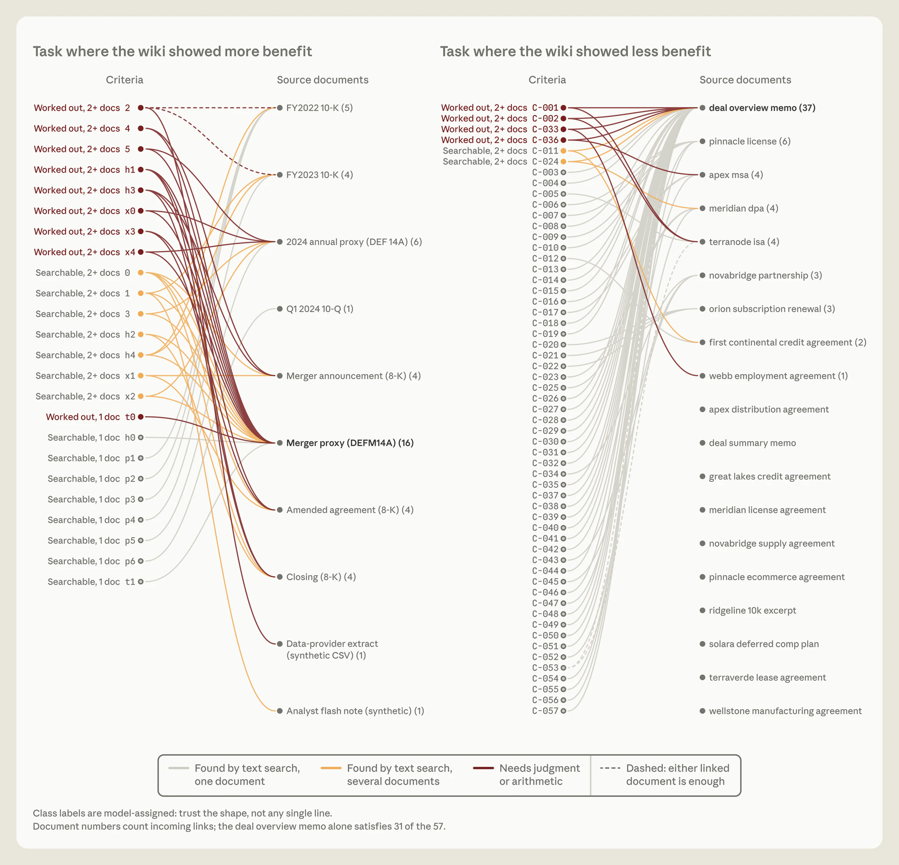

> **图 11**：两张示意图，把评分标准与源文档关联起来。左：wiki 显示出更多收益的那项任务——24 条标准中的大多数都需要连接 10 个文档中的两个或更多，其中九条需要判断或算术。右：wiki 收益不那么明显的那项任务——57 条标准中的大多数都可以通过在单个文档（通常是交易概述备忘录）中进行文本搜索找到。
>
> 说明：每个面板左侧列出被评分的内容，右侧列出满足每一项所需的源文档。左：24 个关于并购的问题，基本可以通过查阅多数为公开披露的文件来回答。超过一半的标准需要综合多个文档的信息。右：一项 LAB 任务，wiki 没有显示出明显收益。大多数标准都可以从单个文档中满足。

在另一些情况下，wiki 用处较小。在一项 LAB 任务中（图 11，右），简报的各项标准常常可以通过对单个文档做文本搜索来检索到，wiki 相对于搜索在表现上没有明显增益。在另一项 LAB 任务中，wiki 长得比文档本身还大（图 12）。就像博尔赫斯那篇只有一段的短篇小说《论科学的精确性》里的制图师一样——他们绘制的地图精细到与它所代表的帝国一样大——Claude 做出了一个极其详尽的 wiki，而它实际上没有抽象出任何东西。

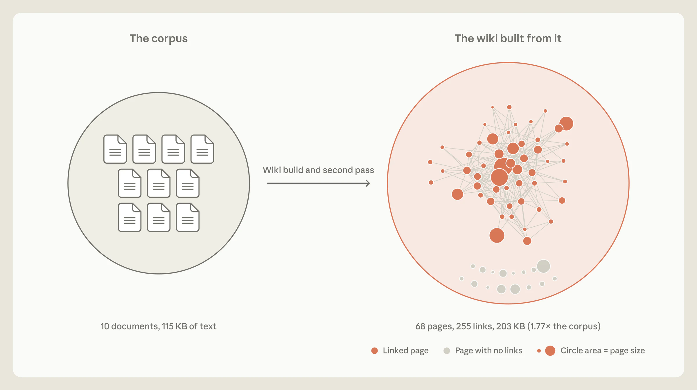

> **图 12**：一个 wiki 的构建与第二轮处理示意图。左侧，一个圆圈代表语料：10 个文档、115 KB 文本。箭头指向一个更大的圆圈，代表由它构建出的 wiki：68 个页面、255 条链接、203 KB，是语料的 1.77 倍。wiki 中有一些页面没有任何链接。
>
> 说明：wiki 长得比原始文件还大。

## Dreaming 可以把笔记提升到记忆层级的更上层

Dreaming 还可以把笔记浮升到记忆层级的顶端，而 agent 的 harness 可以在每个 session 开始时，把这些笔记抢先加载进 Claude 的上下文（图 13）。这意味着 Claude 不必去搜索它们，甚至不必知道有东西可以搜索。

把记忆提升进新的 session（一种*上下文注入*的形式）必须谨慎行事。被注入的记忆会消耗宝贵的 token，而一条不正确的笔记可能会被带进每一个 session。加载一条笔记，也不保证 Claude 会照它行动：我们关于 [Claude Code](https://code.claude.com/docs/en/memory) 的文档就警告说，更长的指令文件会降低遵从率。因此，记忆层级的顶层必须保持相对小，而 dreaming 在这里的许多工作就是维持这一点——把一些细节移到层级更靠下的位置，只留下链接。

[Claude Code 的 auto memory](https://code.claude.com/docs/en/memory) 也用同样的方式让它的注入层保持小，由 Claude 在 session 期间维护这个注入层。Claude 并不会把它的全部 auto memory 都加载进每个 session 的上下文窗口。它只加载 `MEMORY.md` 的前 200 行或 25 KB。这个头部充当一个索引，向 Claude 显示它知道什么、以及在哪里能找到。

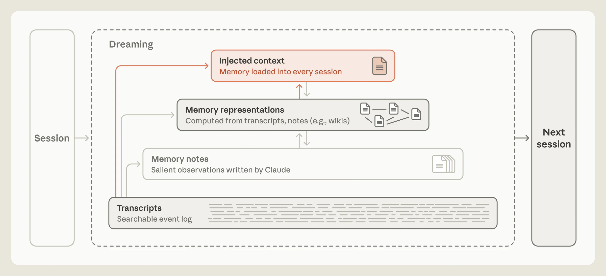

> **图 13**：带 dreaming 的记忆层级，高亮从 transcripts 以及从记忆表征指向顶端注入上下文层的箭头，该层供给下一个 session。
>
> 说明：Dreaming 可以写入记忆层级的顶端。注入上下文会被加载进每个 session，而它下面的各层是在 Claude 需要时才被读取或搜索。

## Dreaming 可以让记忆聚焦于某个特定目标

Dreaming 还可以塑造记忆如何增长。比如，像 [Claude Duet](https://support.claude.com/en/articles/17631495-get-started-with-claude-duet) 这样的助手，往往能从围绕它所服务的那个人来组织的记忆中获益，而 dreaming 可以被调校成服务于某个特定目标来构建记忆。

引导记忆如何增长的这些指令因任务而异，它们告诉 Claude 哪些信息才真正重要。例如，LAB 基准中有一项任务模拟一次公司收购，并提供一组合同。简报的评分依据是它能否正确描述合同条款。

我们最开始使用的是生成 wiki 的基础指令，这些指令没有告诉 Claude *如何*使用 wiki。这项任务严重依赖合同条款。在 wiki 仍在构建的过程中，几个 agent 同时写入一张共享的合同条款表（图 14，左）。

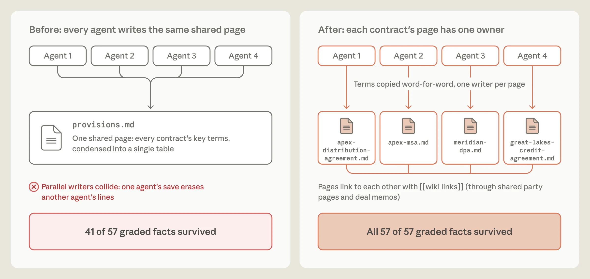

> **图 14**：两张示意图。之前：四个 agent 写入同一个共享页面 `provisions.md`，其中一个 agent 的保存擦掉了另一个 agent 写入的行；57 条受评事实中有 41 条存活。之后：四个 agent 各自写入自己那份合同的页面，条款逐字照抄；57 条受评事实全部 57 条存活。
>
> 说明：指令改变前后，有多少条受评合同事实进入了 wiki。左：多个 agent 写入同一个共享页面；57 条事实中存活了 41 条。右：每份合同一个 agent，各自写入自己的页面并逐字引用条款；57 条事实全部 57 条保留下来。

结果是一个缺失关键事实的 wiki。当我们对基于这个 wiki 生成的简报进行评分时，Claude 只纳入了 57 条事实中的 41 条（72%）。当我们去看问题出在哪里时，发现那张共享表对合同条款的总结很差，而且有些条款完全缺失，原因是 agent 之间覆盖了彼此的工作。

合同条款是 wiki 中最重要的部分，但指令并没有说明这一点。为了找到更好的指令，我们运行了一个循环：Claude 反思自己的失败，提出对指令的修改，并重建 wiki。这个循环让 Claude 发现了"遵循合同条款"有多么重要，于是它相应地重写了构建 wiki 的指令。

每份合同在 wiki 中有了自己的页面，由一个 agent 撰写，并且逐字引用条款，而不是摘要进一张共享表。当我们对基于这个改进后的 wiki 生成的简报进行评分时，100% 的标准都能被满足，而此前是 72%。

## Dreaming 可以填补单个 session 留下的缺口

当 Claude 撰写记忆笔记时，它只能看到*那个*特定 session 中的上下文。Dreaming 可以跨许多 session 进行搜索，以发现共同的模式或纠正共同的错误。

在为 LAB 基准构建 wiki 时（例如图 14 所示），Claude 有时会链接到尚未创建的页面。第二轮 dreaming 处理补上了许多这样的缺口。在其中一项任务中（图 15），dreaming 发现 wiki 中有九条链接指向一个缺失的页面，并把它们重新指向同一文档的既有页面。它还新增了三个页面（其中包括一个索引）来改进这个 wiki。

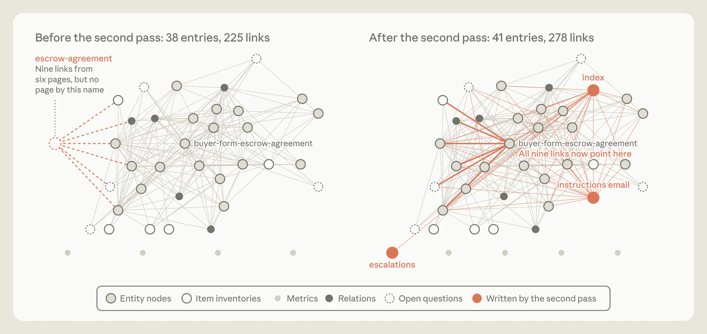

> **图 15**：一个 wiki 的两张网络图。第二轮处理之前：38 个条目、225 条链接，其中有来自六个页面的九条链接指向一个并不存在的页面 `escrow-agreement`。之后：41 个条目、278 条链接，那九条链接全部指向 `buyer-form-escrow-agreement`，并新增了三个页面：index、instructions email 和 escalations。
>
> 说明：第二轮 dreaming 处理前后的 wiki。

## 倒着思考，向前看

关于如何为 agent 设计记忆系统，还有许多开放问题。其中之一是 Claude 应该在什么时候创建记忆。当 Claude 在处理一项任务时，它可以写入一个记忆存储（例如一个文件夹、文件或数据库），在源头处捕捉显著性，并让重要细节立即可用于未来的轮次或 session。但在当下记笔记，不可避免地会把 Claude 的注意力从主任务上引开。相反，dreaming 可以把记忆创建推到后台，但 dreaming 的任何产出可能无法立即被 Claude 访问。

另一个问题是如何让记忆可靠地保持最新。Claude 可能做出错误的预测，或者往记忆里写下从一开始就是错的规则。记忆也可能随着环境变化而漂移、变得无关。Dreaming 是修正这些错误的一种方式（图 8），但它需要算力。指示 Claude 持续检查它的*全部*记忆，可能并不现实。重要的也许是转而让 dreaming 聚焦于那些很可能变化的信息，或者仔细调校 dreaming 的节奏（例如依据记忆被访问的频率）。

把 transcript 搜索当作 Claude 记忆的基础，也是合理的考虑。把表征（例如 wiki）与搜索结合起来（图 10），有时确实有效。但 Claude 需要消耗算力来维护记忆表征，并确保它们不会累积错误或幻觉。

尽管 Claude 对显著性的判断已经有所改善，但没有哪个模型能真正知道未来几轮会发生什么。Dreaming 给了 Claude 一个机会去*倒着*看，并用算力来组织它的记忆、修正错误、维护表征，使未来的 session 更容易访问到记忆。记忆系统将随 Claude 变得更有能力而演进，而关于如何设计 Claude 的记忆系统，我们还有很多要学。

关于[开始使用 dreaming](https://platform.claude.com/cookbook/managed-agents-cma-dreaming-with-a-dynamic-workflow) 和 [知识 wiki](https://github.com/anthropics/claude-quickstarts/tree/main/managed-agents/knowledge-wiki) 的示例，请参见我们的 cookbook。

## 作者与致谢

### 致谢

本文由 Lance Martin 撰写，编辑指导来自 Caitlin Love、Tom Chivers、Rebecca Hiscott、Jake Eaton 和 Blake Wilson。我们感谢 Barry Zhang、Theodora Chu、Daliang Li、Mahesh Murag、Jake Noble、Ravi Trivedi、Tina Vachovsky、Brad Abrams、Henry de Valence、Jeremy Fox、Matt Bell、Allen Li、Chris Gorgolewski、Eugene Yan、Artur Renault、Wei Zhang 和 Kevin Chen 的有益讨论与贡献，并感谢 David Hershey 提供的 "Claude Plays Pokémon"。图表由 Monika Tuchowska 制作。
