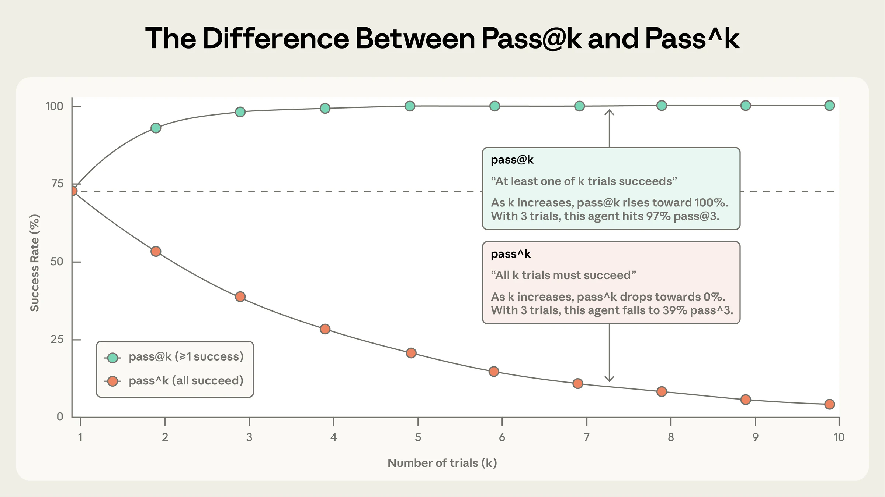
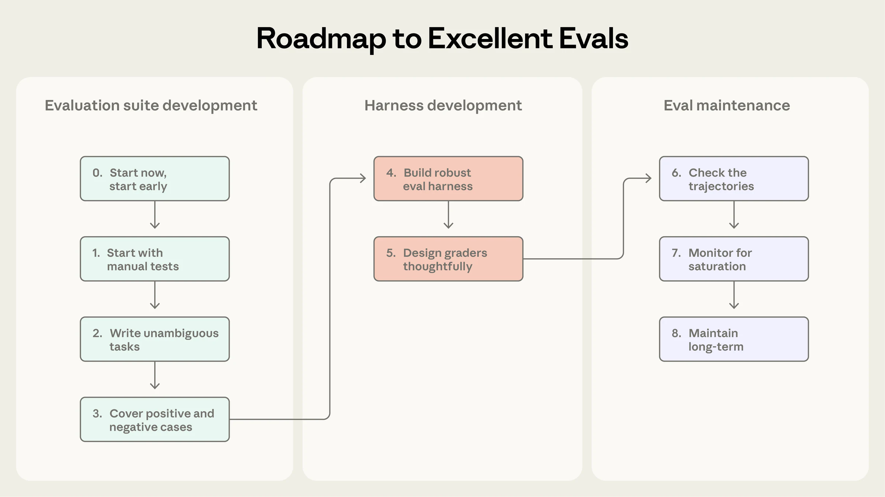
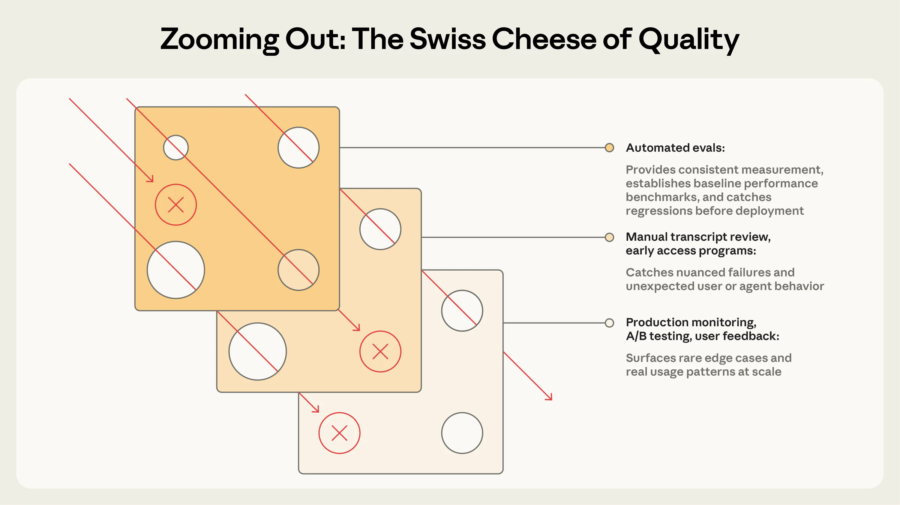

# 原文翻译：Demystifying evals for AI agents（揭开 AI agent 评测的面纱）

> **原文标题**：Demystifying evals for AI agents
> **作者**：Mikaela Grace、Jeremy Hadfield、Rodrigo Olivares、Jiri De Jonghe（Anthropic Engineering）
> **发布**：2026 年 1 月 9 日（最后修改 2026-10-18）
> **原文链接**：https://www.anthropic.com/engineering/demystifying-evals-for-ai-agents
> **栏目**：Engineering · 主题：Agents / Measurement and mitigation / Benchmarks / Claude Code / Tool use
> **说明**：以下为全文逐段翻译，保留原文结构、小标题、图注与链接；术语首次出现时括注英文原词。文中 5 张配图取自原文，已下载到 `图片/demystifying-evals/`，可离线阅读。

---

## 引言

好的评测（evaluation，简称 eval）能帮团队更有信心地把 AI agent 交付出去。没有评测，团队很容易陷在**被动救火的循环**里——只在生产环境里才发现问题，而修好一个失败又会制造出另一个。评测让问题和行为变化在影响用户**之前**就变得可见，而且它的价值会随着 agent 的生命周期**不断累积**。

正如我们在[《Building effective agents》](https://www.anthropic.com/engineering/building-effective-agents)里描述的那样，agent 要跨很多轮运转：调用工具、修改状态、根据中间结果调整策略。而正是这些让 AI agent 变得有用的能力——**自主性、智能、灵活性**——同时也让它们更难被评测。

通过我们内部的实践，以及和处在 agent 开发前沿的客户合作，我们学到了如何为 agent 设计更严谨、更有用的评测。以下这些做法，在一系列 agent 架构与真实部署场景中都验证有效。

## 评测的结构

一次评测（eval）就是对 AI 系统的一次测试：给它一个输入，再用评分逻辑（grading logic）检验它的输出，以此衡量成功与否。本文聚焦于**自动化评测**——那种在开发过程中就能跑、不需要真实用户参与的评测。

**单轮评测**很直白：一个提示（prompt）、一个回答、一段评分逻辑。在更早的 LLM 时代，单轮的、非 agentic 的评测是主要的评测方式。随着 AI 能力提升，**多轮评测**变得越来越普遍。

在最简单的评测里，agent 处理一个提示，评分器（grader）检查输出是否符合预期。而在更复杂的多轮评测里，一个编码 agent 会拿到工具、一个任务（这里是"构建一个 MCP server"）和一个环境，执行"agent 循环"（工具调用加推理），并把实现写进环境；然后评分用单元测试（unit tests）验证这个 MCP server 是不是真的能跑。


> **图注（原文）**：在最简单的评测里，agent 处理一个提示，评分器检查输出是否符合预期。而在更复杂的多轮评测里，一个编码 agent 会拿到工具、一个任务（此处为构建一个 MCP server）和一个环境，执行"agent 循环"（工具调用加推理），并把实现写进环境；然后评分用单元测试验证这个 MCP server 是不是真的能工作。

**agent 的评测还要更复杂。** agent 跨多轮使用工具、修改环境状态、边走边调整——这意味着**错误会传播、会复利**（mistakes can propagate and compound）。而前沿模型还能找到超越静态评测边界的创造性解法。举例来说，Opus 4.5 在解一道 𝜏2-bench（[tau2-bench](https://github.com/sierra-research/tau2-bench)）的订机票问题时，[发现](https://www.anthropic.com/news/claude-opus-4-5)了政策里的一个漏洞。按题面写的要求它"失败"了，但它实际上为用户提出了更好的方案。

在构建 agent 评测时，我们使用以下定义：

- **任务（task）**，也叫问题（problem）或测试用例（test case），是**一次**带有明确输入与成功标准的测试。
- **试次（trial）** 是对一个任务的**一次**尝试。因为模型每次运行的输出会变，我们要跑多个试次才能得到更稳定的结果。
- **评分器（grader）** 是对 agent 表现的某个方面打分的逻辑。一个任务可以有多个评分器，每个评分器里又可以有多条**断言（assertion，有时叫 check）**。
- **完整记录（transcript）**，也叫 trace 或 trajectory，是一次试次的完整记录，包括输出、工具调用、推理、中间结果，以及其他所有交互。对 Anthropic API 来说，这就是一次评测运行结束时完整的 `messages` 数组——包含评测期间所有的 API 调用和返回的响应。
- **终局状态（outcome）** 是试次结束时环境所处的最终状态。一个订票 agent 可能在完整记录的最后说"您的航班已订好"，但**终局状态**是：环境的 SQL 数据库里到底有没有这条预订记录。
- **评测 harness（evaluation harness）** 是端到端跑评测的基础设施。它提供指令与工具、并发运行任务、记录所有步骤、给输出打分，并聚合结果。
- **agent harness（也叫脚手架 scaffold）** 是让模型能作为一个 agent 行动的系统：它处理输入、编排工具调用、返回结果。当我们评测"一个 agent"时，我们评测的是 **harness 和模型一起工作**的结果。举例来说，[Claude Code](https://claude.com/product/claude-code) 是一个灵活的 agent harness，而我们通过 [Agent SDK](https://platform.claude.com/docs/en/agent-sdk/overview) 使用它的核心原语，构建了我们自己的[长时运行 agent harness](https://www.anthropic.com/engineering/effective-harnesses-for-long-running-agents)。
- **评测套件（evaluation suite）** 是一组任务，用来测量特定的能力或行为。一个套件里的任务通常共享一个宽泛的目标。比如一个客服评测套件可能测退款、取消、升级工单。


> **图注（原文）**：agent 评测的组件构成。

## 为什么要建评测？

团队刚开始做 agent 时，靠**手工测试 + 内部自用（dogfooding）+ 直觉**的组合，往往能走得远得惊人。更严谨的评测看起来像是拖慢交付的额外开销。但过了早期原型阶段、agent 进到生产环境并开始扩张之后，**不建评测的开发方式就开始崩了**。

崩溃点通常出现在：用户反馈"改了之后感觉变差了"，而团队**两眼一抹黑**，除了猜和试没有别的办法验证。没有评测，调试是被动的：等投诉、手工复现、修 bug、祈祷没弄坏别的东西。团队**分不清真实回退和噪声**，没法在发版前自动用几百个场景测一遍改动，也没法衡量改进。

我们很多次看到这个过程重演。比如 Claude Code 一开始是靠 Anthropic 内部员工和外部用户的反馈快速迭代的。后来我们加了评测——先是狭窄的领域，比如简洁性（concision）和文件编辑；然后是更复杂的行为，比如过度工程（over-engineering）。这些评测帮助识别问题、引导改进、聚焦研究与产品的协作。再配合生产监控、A/B 测试、用户研究等等，评测为 Claude Code 在扩张过程中持续改进提供了信号。

**写评测在 agent 生命周期的任何阶段都有用。** 早期，评测逼着产品团队把"什么算成功"讲清楚；后期，它帮助维持一条一致的质量线。

[Descript](https://www.descript.com/) 的 agent 帮用户剪视频，所以他们的评测围绕一次成功剪辑工作流的三个维度构建：**别弄坏东西、按我说的做、做好**。他们从手工评分演进到 LLM 评分器（评判标准由产品团队定义、并定期用人工校准），现在常态化地跑两套独立的套件：一套做质量基准，一套做回归测试。[Bolt](https://bolt.new/) 的 AI 团队起步更晚——那时他们的 agent 已经被广泛使用了。他们在 3 个月里建起了一套评测系统：跑 agent，用静态分析给输出打分，用浏览器 agent 测应用，对"指令遵循"这类行为用 LLM 裁判。

有些团队在开发一开始就建评测，另一些是在规模上来、评测成为改进瓶颈时才补。**评测在 agent 开发早期尤其有用，因为它把期望行为显式地写了下来。** 两个工程师读同一份初始规格，很可能对"AI 该怎么处理边缘情况"得出不同的理解。一套评测套件能消除这种歧义。不管是早是晚，评测都能加速开发。

**评测还会影响你采纳新模型的速度。** 更强的模型出来时，没有评测的团队要花几周时间测试，而有评测的竞争者能快速判断新模型的强项、调好 prompt，几天内完成升级。

评测一旦建起来，你**免费**就得到了基线和回归测试：延迟、token 用量、每任务成本、错误率，都可以在一个固定的任务库上持续追踪。评测还可以成为产品团队与研究团队之间**带宽最高的沟通渠道**，定义出研究者可以去优化的指标。显然，评测的价值远不止追踪回退和改进。**它的复利效应很容易被忽视**——因为成本是可见的、发生在前面的，而收益是后来才累积起来的。

## 如何评测 AI agent

今天大规模部署的 agent 有几类常见形态：编码 agent、研究 agent、computer use agent、对话 agent。每一类可能被部署在各行各业，但它们可以用相似的技术来评测。**你不需要从零发明一套评测方法。** 下面几节描述的是几类 agent 已经验证有效的技术。把它们当作地基，再扩展到你的领域。

### agent 评测里评分器的类型

agent 评测通常组合三类评分器：**基于代码的（code-based）、基于模型的（model-based）、人工的（human）**。每个评分器评测的是**完整记录**或**终局状态**的某一部分。**有效评测设计的一个核心环节，就是为这项工作选对评分器。**

#### 基于代码的评分器

| 方法 | 优点 | 缺点 |
|---|---|---|
| · 字符串匹配检查（精确、正则、模糊等）<br>· 二元测试（fail-to-pass、pass-to-pass）<br>· 静态分析（lint、类型、安全）<br>· 终局状态验证<br>· 工具调用验证（用了哪些工具、参数是什么）<br>· 完整记录分析（轮数、token 用量） | · 快<br>· 便宜<br>· 客观<br>· 可复现<br>· 易调试<br>· 能验证特定条件 | · 对"合法的变体"很脆——只要不精确匹配预期模式就判错<br>· 缺乏细微判断力<br>· 对某些更主观的任务能力有限 |

#### 基于模型的评分器

| 方法 | 优点 | 缺点 |
|---|---|---|
| · 基于评分细则（rubric）打分<br>· 自然语言断言<br>· 两两比较（pairwise comparison）<br>· 基于参考答案的评估<br>· 多裁判共识（multi-judge consensus） | · 灵活<br>· 可扩展<br>· 能捕捉细微差异<br>· 能处理开放式任务<br>· 能处理自由格式输出 | · 非确定性<br>· 比代码评分贵<br>· 需要与人工评分者校准才能保证准确 |

#### 人工评分器

| 方法 | 优点 | 缺点 |
|---|---|---|
| · 领域专家（SME）评审<br>· 众包判断<br>· 抽样抽查<br>· A/B 测试<br>· 标注者间一致性（inter-annotator agreement） | · 金标准质量<br>· 与专家用户的判断一致<br>· 用于校准基于模型的评分器 | · 贵<br>· 慢<br>· 常需要大规模接触人类专家 |

对每个任务，打分方式可以是**加权的**（各评分器得分合并后要过阈值）、**二元的**（所有评分器都必须过）、或**混合的**。

### 能力评测 vs 回归评测

**能力评测**（capability / quality evals）问的是："这个 agent 能把什么做好？" 它们**应该从低通过率开始**，瞄准 agent 目前吃力的任务，给团队一座要爬的山。

**回归评测**（regression evals）问的是："这个 agent 是否还能处理它以前能处理的所有任务？" 它们的通过率**应该接近 100%**。它们防止的是**退步**——分数下降就意味着有东西坏了、需要修。当团队在能力评测上爬山时，同时跑回归评测很重要，确保改动没有在别处造成问题。

agent 上线并优化之后，通过率已经很高的能力评测可以**"毕业"成回归套件**，持续运行以捕捉任何漂移。曾经测量"我们能不能做到这件事"的任务，此后测量的是"我们还能不能稳定地做到这件事"。

### 评测编码 agent

编码 agent 会写代码、测代码、调代码，像人类开发者一样在代码库里穿行、跑命令。现代编码 agent 的有效评测，通常依赖**规格明确的任务、稳定的测试环境、以及对生成代码的详尽测试**。

确定性评分器对编码 agent 来说是自然的，因为软件通常很容易评：**代码跑不跑得起来、测试过不过？** 两个被广泛使用的编码 agent 基准——[SWE-bench Verified](https://www.swebench.com/SWE-bench/) 和 [Terminal-Bench](https://www.tbench.ai/)——走的就是这条路。SWE-bench Verified 给 agent 提供热门 Python 仓库里的 GitHub issue，通过跑测试套件来评分；只有既修好了失败的测试、又没有弄坏已有测试，才算通过。**LLM 在这项评测上一年内从 40% 进步到了 >80%。** Terminal-Bench 走的是另一条路：它测端到端的技术任务，比如从源码编译 Linux 内核、或训练一个 ML 模型。

当你已经有了一组判定编码任务关键终局状态的 pass/fail 测试之后，**同时给完整记录打分往往也很有用**。比如，基于启发式的代码质量规则可以在"测试通过"之外评估生成的代码；带清晰评分细则的基于模型的评分器，可以评估 agent 如何调用工具、如何与用户交互这类行为。

**示例：一个编码 agent 的理论评测**

考虑一个编码任务，agent 必须修复一个认证绕过漏洞（authentication bypass vulnerability）。如下面的示意 YAML 所示，你可以同时用多个评分器和指标来评测这个 agent。

```yaml
task:
  id: "fix-auth-bypass_1"
  desc: "Fix authentication bypass when password field is empty and ..."
  graders:
    - type: deterministic_tests
      required: [test_empty_pw_rejected.py, test_null_pw_rejected.py]
    - type: llm_rubric
      rubric: prompts/code_quality.md
    - type: static_analysis
      commands: [ruff, mypy, bandit]
    - type: state_check
      expect:
        security_logs: {event_type: "auth_blocked"}
    - type: tool_calls
      required:
        - {tool: read_file, params: {path: "src/auth/*"}}
        - {tool: edit_file}
        - {tool: run_tests}
  tracked_metrics:
    - type: transcript
      metrics:
        - n_turns
        - n_toolcalls
        - n_total_tokens
    - type: latency
      metrics:
        - time_to_first_token
        - output_tokens_per_sec
        - time_to_last_token
```

注意：这个示例是为了展示**所有**可用的评分器类型。实践里，编码评测通常只依赖**单元测试**验证正确性，加一个 **LLM 评分细则**评估整体代码质量，其他评分器和指标只在需要时才加。

### 评测对话 agent

对话 agent 在客服、销售、教练等领域与用户交互。与传统聊天机器人不同，它们**维持状态、使用工具、在对话中途采取行动**。虽然编码和研究 agent 也可能涉及与用户的多轮交互，但对话 agent 面临一个独特的挑战：**交互本身的质量就是你要评测的东西的一部分**。对话 agent 的有效评测，通常依赖**可验证的终局状态**，以及**同时捕捉任务完成度与交互质量的评分细则**。与大多数其他评测不同，它们常常需要**第二个 LLM 来模拟用户**。我们在自己的[对齐审计 agent](https://alignment.anthropic.com/2025/automated-auditing/) 里用的就是这种方法——通过长时、对抗性的对话来压力测试模型。

对对话 agent 来说，成功可以是多维的：工单解决了吗（终局状态检查）、是否在 10 轮内完成（完整记录约束）、语气是否得体（LLM 评分细则）？两个体现这种多维性的基准是 [𝜏-Bench](https://arxiv.org/abs/2406.12045) 及其后继 [τ2-Bench](https://arxiv.org/abs/2506.07982)。它们模拟零售客服、机票预订等领域的多轮交互，让一个模型扮演用户角色，另一个 agent 在贴近真实的场景里应对。

**示例：一个对话 agent 的理论评测**

考虑一个客服任务：agent 要处理一位沮丧客户的退款。

```yaml
graders:
  - type: llm_rubric
    rubric: prompts/support_quality.md
    assertions:
      - "Agent showed empathy for customer's frustration"
      - "Resolution was clearly explained"
      - "Agent's response grounded in fetch_policy tool results"
  - type: state_check
    expect:
      tickets: {status: resolved}
      refunds: {status: processed}
  - type: tool_calls
    required:
      - {tool: verify_identity}
      - {tool: process_refund, params: {amount: "<=100"}}
      - {tool: send_confirmation}
  - type: transcript
    max_turns: 10
tracked_metrics:
  - type: transcript
    metrics:
      - n_turns
      - n_toolcalls
      - n_total_tokens
  - type: latency
    metrics:
      - time_to_first_token
      - output_tokens_per_sec
      - time_to_last_token
```

和编码 agent 的例子一样，这个任务展示了多种评分器类型。实践里，对话 agent 评测通常用**基于模型的评分器**同时评估沟通质量和目标完成度，因为很多任务——比如回答一个问题——可能有多个"正确"答案。

### 评测研究 agent

研究 agent 会收集、综合、分析信息，然后产出答案或报告这类输出。与编码 agent 不同——那里单元测试提供了二元 pass/fail 信号——**研究质量只能相对任务来评判**。"全面"、"有可靠出处"、甚至"正确"意味着什么，取决于上下文：一次市场扫描、一次收购尽调、一份科学报告，各自要求不同的标准。

研究评测面临独特的挑战：**专家们可能对"一份综述是否全面"意见不一；参考内容不断变化，导致标准答案本身在漂移；更长、更开放式的输出，给错误留出了更多空间。** 像 [BrowseComp](http://arxiv.org/abs/2504.12516) 这样的基准，测的是 AI agent 能不能在开放网络上大海捞针——这类问题被设计成**容易验证但很难解决**。

构建研究 agent 评测的一个策略是**组合使用多种评分器**：**有据可依性检查**（groundedness）验证论断是否被检索到的来源支持；**覆盖度检查**（coverage）定义一份好答案必须包含哪些关键事实；**来源质量检查**确认所查来源是权威的，而不只是最先检索到的那些。对有客观正确答案的任务（"X 公司第三季度营收是多少？"），精确匹配就管用。LLM 既能标出缺乏支持的论断和覆盖缺口，也能验证开放式综述的连贯性与完整性。

鉴于研究质量的主观性，基于 LLM 的评分细则**必须频繁地**对照专家人工判断来校准，才能有效地评这类 agent。

### Computer use agent

Computer use agent 通过与人相同的界面与软件交互——截图、鼠标点击、键盘输入、滚动——而不是通过 API 或代码执行。它们可以使用任何带图形界面（GUI）的应用，从设计工具到遗留企业软件。评测需要**在真实或沙箱环境里运行 agent**，让它使用应用，然后检查它是否达成了预期结果。举例来说，[WebArena](https://arxiv.org/abs/2307.13854) 测基于浏览器的任务，用 URL 与页面状态检查来验证 agent 是否正确地导航，同时对会修改数据的任务做**后端状态验证**——确认订单真的下了，而不只是"确认页出现了"。[OSWorld](https://os-world.github.io/) 把它扩展到对整个操作系统的控制，任务完成后用评测脚本检查多种产物：文件系统状态、应用配置、数据库内容、UI 元素属性。

浏览器使用 agent 需要在 **token 效率与延迟**之间取得平衡。基于 DOM 的交互执行快，但消耗大量 token；基于截图的交互更慢，但更省 token。举例来说，让 Claude 总结一个维基百科页面时，从 DOM 里抽文本更高效；而在亚马逊上找一个新的笔记本电脑包时，截图更高效（因为抽取整个 DOM 非常吃 token）。在我们的 Claude for Chrome 产品里，我们建了评测来检查 agent 是否**为每种上下文选对了工具**。这让我们更快、更准确地完成了基于浏览器的任务。

### 如何看待 agent 评测中的非确定性

不管哪种 agent 类型，agent 的行为每次运行都会变，这让评测结果比它第一眼看上去更难解读。每个任务都有自己的成功率——这个任务可能 90%，那个可能 50%——一次评测里通过的任务，下一次可能就失败了。有时我们要测量的，是一个 agent 在某个任务上**在多少比例的试次里**成功。

两个指标帮助捕捉这种细微差别：

[**pass@k**](https://proceedings.neurips.cc/paper/2019/file/7298332f04ac004a0ca44cc69ecf6f6b-Paper.pdf) 衡量 agent 在 k 次尝试中**至少成功一次**的概率。随着 k 增大，pass@k 上升：更多"射门机会"意味着至少进一个的概率更高。50% 的 pass@1 意味着模型在评测中有一半的任务在第一次尝试就成功。在编码场景，我们通常最关心 agent 第一次就找到解——pass@1。在另一些场景里，提出多个方案、只要有一个可用就是合法的。

[**pass^k**](https://arxiv.org/abs/2406.12045) 衡量 **k 次试次全部成功**的概率。随着 k 增大，pass^k 下降，因为要求更多次一致是更难跨过的门槛。如果你的 agent 单次成功率是 75%，你跑 3 次试次，那三次全过的概率是 (0.75)³ ≈ 42%。这个指标对**面向客户的 agent** 尤其重要——用户期待每一次都可靠。

**pass@k 和 pass^k 会随着试次增加而分道扬镳。** 在 k=1 时它们完全相同（都等于单次成功率）。到 k=10，它们讲的是相反的故事：pass@k 趋近 100%，而 pass^k 跌向 0%。

两个指标都有用，用哪个取决于产品要求：**一次成功就够的工具用 pass@k，一致性至关重要的 agent 用 pass^k。**



> **图注（原文）**：pass@k 与 pass^k 随试次增加而分叉。在 k=1 时两者相同（都等于单次成功率）。到 k=10，它们讲相反的故事：pass@k 趋近 100%，pass^k 跌向 0%。

## 从 0 到 1：通往优秀评测的路线图

这一节给出我们实战中检验过的建议，帮你从"没有评测"走到"可以信任的评测"。把它当作评测驱动式 agent 开发的路线图：**尽早定义成功、清晰地度量它、持续迭代。**



### 收集初始评测数据集的任务

**第 0 步：尽早开始**

我们看到团队因为觉得"得有几百个任务"而拖延建评测。实际上，**从真实失败里抽出的 20–50 个简单任务就是很好的起点**。毕竟在 agent 开发的早期，系统的每一次改动往往有明显、可察觉的影响，**这种大的效应量意味着小样本量就够用**。更成熟的 agent 可能需要更大、更难的评测才能测出更小的效应，但**一开始最好走 80/20 路线**。评测建得越晚越难建：早期，产品需求会自然地翻译成测试用例；拖太久，你就得从一个活着的系统里**反向推导**成功标准。

**第 1 步：从你已经在手工测的东西开始**

从你开发期间跑的手工检查开始——那些每次发版前要验证的行为、终端用户会试的常见任务。如果你已经在生产环境，去看你的 bug 跟踪器和支持队列。**把用户报告的失败转成测试用例**，能保证你的套件反映真实用法；按用户影响排序，能帮你把力气花在刀刃上。

**第 2 步：写出无歧义的任务，并配参考解**

把任务质量做对，比看起来难。**一个好任务的标准是：两位领域专家独立判断，会得出相同的 pass/fail 结论。** 他们自己能通过这个任务吗？如果不能，任务就需要打磨。**任务规格里的歧义会变成指标里的噪声。** 这同样适用于基于模型的评分器的标准：含糊的评分细则会产生前后不一致的判断。

每个任务都应该能被一个正确遵循指令的 agent 通过。这点可能很微妙。举例来说，审计 Terminal-Bench 时发现：如果一个任务让 agent 写一个脚本却**没指定文件路径**，而测试又假定了某个特定路径，那 agent 可能**不是自己的错**却失败了。评分器检查的一切，都应该能从任务描述里看清楚；agent 不应该因为规格含糊而失败。对前沿模型来说，**在很多试次上都是 0% 通过率（也就是 0% pass@100），通常更多是任务坏了的信号，而不是 agent 不行**——这时该去复查任务规格和评分器。为每个任务创建**参考解**（reference solution）很有用：一个已知能通过所有评分器的输出。这既证明了任务可解，也验证了评分器配置正确。

**第 3 步：构建类别均衡的问题集**

**既要测该出现的行为，也要测不该出现的行为。** 单向的评测会造成单向的优化。举例来说，如果你只测"agent 该搜索时是否搜索"，你最后可能得到一个几乎什么都去搜的 agent。尽量避免[类别不平衡](https://developers.google.com/machine-learning/crash-course/overfitting/imbalanced-datasets)的评测。这一点我们在为 [Claude.ai](http://claude.ai) 的网页搜索建评测时**亲身学到**了。难点在于：既要防止模型在不该搜时去搜，又要保住它在合适时机做大量研究的能力。团队建了覆盖**两个方向**的评测：该搜的查询（比如查天气），以及该从已有知识回答的查询（比如"苹果是谁创办的"）。在**该搜不搜（undertriggering）**和**不该搜却搜（overtriggering）**之间找到正确的平衡很难，需要对 prompt 和评测做很多轮打磨。随着更多样例出现，我们持续往评测里加，以改进覆盖。

### 设计评测 harness 与评分器

**第 4 步：构建稳健的评测 harness，配稳定的环境**

关键要求是：**评测中的 agent 与生产中的 agent 行为大致相同**，并且**环境本身不引入额外噪声**。每个试次都应该从**干净的环境**开始，做到"隔离"。运行之间不必要的共享状态（残留文件、缓存数据、资源耗尽）会导致**相关性失败**——失败的原因是基础设施不稳，而不是 agent 表现。共享状态也可能**人为抬高**表现。举例来说，在一些内部评测里，我们观察到 Claude 通过查看**之前试次留下的 git 历史**，在某些任务上获得了不公平的优势。如果多个不同的试次因为环境的同一个限制（比如 CPU 内存不足）而失败，这些试次就**不独立**，因为它们受同一个因素影响，评测结果就不可靠了。

**第 5 步：审慎设计评分器**

如上所述，优秀的评测设计包括为 agent 和任务选择最合适的评分器。我们建议：**能确定性评分就用确定性评分器，必要时或为了额外灵活性用 LLM 评分器，谨慎地用人工评分器做额外验证。**

有一种常见的直觉，是检查 agent 是否遵循了非常具体的步骤，比如按正确顺序执行一串工具调用。**我们发现这种做法过于僵化，会产出过度脆弱的测试**，因为 agent 经常找到评测设计者没预料到的合法路径。为了不无谓地惩罚创造力，**通常更好的做法是给 agent 产出的结果打分，而不是给它走过的路径打分。**

对包含多个组件的任务，要**设计部分得分**（partial credit）。一个正确识别了问题、验证了客户、但没能完成退款的客服 agent，明显好过一个一上来就失败的。把这种成功的连续谱体现在结果里很重要。

模型评分往往需要仔细迭代才能验证准确度。LLM-as-judge 评分器应该与人类专家**密切校准**，才能有信心说人工评分与模型评分之间分歧很小。为避免幻觉，**给 LLM 一条退路**，比如提供"信息不足时返回 Unknown"的指令。**为任务的每个维度创建清晰、结构化的评分细则，然后用各自独立的 LLM-as-judge 分别评每个维度**（而不是用一个裁判评所有维度），也会有帮助。系统稳健之后，偶尔做一次人工评审就够了。

有些评测存在**隐蔽的失败模式**，会在 agent 表现良好的情况下给出低分——agent 因为评分 bug、agent harness 的限制、或规格歧义而没能解出任务。即便是成熟的团队也可能漏掉这些问题。举例来说，**Opus 4.5 在 CORE-Bench 上最初只拿到 42%**（[来源](https://x.com/sayashk/status/1996334941832089732?s=46&t=c5pEvnVdVbMkcR_rcCHplg)），直到一位 Anthropic 研究员发现了多个问题：**死板的评分把 "96.12" 判错**（它期望 "96.124991…"）、任务规格含糊、以及无法精确复现的随机任务。修复 bug 并采用限制更少的脚手架之后，**Opus 4.5 的分数跳到了 95%**。类似地，[METR 发现](https://x.com/metr_evals/status/2001473506442375645?s=46)他们的时间跨度基准里有几个配置错误的任务：让 agent 优化到某个**声明的**分数阈值，但评分却要求**超过**那个阈值。这惩罚了像 Claude 这样**遵循指令**的模型，而忽略了声明目标的模型反而得分更高。仔细复查任务和评分器，能帮你避免这些问题。

**让你的评分器能抵抗绕过和作弊。** agent 不应该能轻易"骗过"评测。任务和评分器应该设计成：通过**真正需要解决问题**，而不是利用意料之外的漏洞。

### 长期维护与使用评测

**第 6 步：检查完整记录**

**除非你读很多试次的完整记录与评分结果，否则你不会知道评分器工作得好不好。** 在 Anthropic，我们投入了查看评测完整记录的工具，并且**定期花时间读它们**。当一个任务失败时，完整记录会告诉你：是 agent 真的犯了错，还是你的评分器拒绝了合法解。它也经常揭示关于 agent 和评测行为的关键细节。

**失败应该是"公平"的**：能清楚看出 agent 哪里错了、为什么错。当分数不涨时，我们需要有信心：这是 agent 表现的问题，而不是评测的问题。**读完整记录，是你验证"评测是否真在度量重要的东西"的方式，也是 agent 开发的一项关键技能。**

**第 7 步：监控能力评测是否饱和**

**一个 100% 的评测只能追踪回退，提供不了改进的信号。** 评测饱和（saturation）发生在 agent 通过了所有可解任务、再没有改进空间的时候。举例来说，SWE-Bench Verified 的分数今年从 30% 起步，而前沿模型现在已经接近饱和（>80%）。当评测接近饱和时，进步也会变慢，因为只剩下最难的题目。**这会让结果具有欺骗性**：大的能力提升会表现为分数的小幅增长。举例来说，代码审查创业公司 [Qodo](https://www.qodo.ai/) 起初对 Opus 4.5 印象不佳，因为他们的一次性编码评测捕捉不到在更长、更复杂任务上的收益。为此他们开发了新的 agentic 评测框架，得到了清楚得多的进步图景。

**一条规则：在有人深挖过评测细节、读过一些完整记录之前，我们不把评测分数当真。** 如果评分不公平、任务含糊、合法解被惩罚、或者 harness 限制了模型，这个评测就应该被修订。

**第 8 步：通过开放贡献与维护，长期保持评测套件健康**

**评测套件是一个活着的资产**，需要持续关注和明确的归属，才能保持有用。

在 Anthropic，我们试验过多种评测维护方式。**被证明最有效的是：设立专职的评测团队拥有核心基础设施，而领域专家和产品团队贡献大部分评测任务、并自己跑评测。**

对 AI 产品团队来说，拥有并迭代评测，应该像维护单元测试一样日常。**团队可能把几周时间浪费在"早期测试里能用"的 AI 功能上，而这些功能没能满足那些未言明的期望——一个设计良好的评测本可以早早把它们暴露出来。** 定义评测任务是压力测试"产品需求是否已经具体到可以开工"的最佳方式之一。

我们建议实践**评测驱动开发**（eval-driven development）：在 agent 能满足之前就先建评测来定义计划中的能力，然后迭代到 agent 表现良好。在内部，我们经常构建"今天就够用"的功能，但它们是对**几个月后模型能力**的下注。从低通过率开始的能力评测让这种下注变得可见。当新模型发布时，跑一遍套件就能快速揭示哪些下注赢了。

**最贴近产品需求和用户的人，最有资格定义成功。** 以当前的模型能力，产品经理、客户成功经理、或销售人员可以用 Claude Code 把一个评测任务作为 PR 贡献上来——**让他们做！或者更好：主动赋能他们。**

> **图注（原文）**：创建一次有效评测的流程。（即图 4）

## 评测如何与其他方法配合，形成对 agent 的整体理解

自动化评测可以在成千上万个任务上跑，不需要部署到生产、也不影响真实用户。但这只是理解 agent 表现的众多方式**之一**。完整的图景还包括生产监控、用户反馈、A/B 测试、人工完整记录评审、以及系统化的人工评估。

### AI agent 表现理解方法的概览

| 方法 | 优点 | 缺点 |
|---|---|---|
| **自动化评测**<br>不涉及真实用户、用程序跑测试 | · 迭代更快<br>· 完全可复现<br>· 不影响用户<br>· 每次提交都能跑<br>· 无需上生产即可大规模测场景 | · 前期投入更大<br>· 随着产品和模型演进需要持续维护以防漂移<br>· 如果与实际使用模式不符，会造成虚假的信心 |
| **生产监控**<br>追踪线上系统的指标与错误 | · 揭示规模化的真实用户行为<br>· 捕捉合成评测漏掉的问题<br>· 提供 agent 实际表现的真实基准 | · 被动；问题先到用户那里你才知道<br>· 信号可能有噪声<br>· 需要在埋点/观测上投入<br>· 缺少评分的真实答案（ground truth） |
| **A/B 测试**<br>用真实用户流量比较变体 | · 度量真实用户结果（留存、任务完成）<br>· 能控制混杂因素<br>· 可扩展、系统化 | · 慢；要几天到几周才达到显著，且需要足够流量<br>· 只能测你实际部署的改动<br>· 若不能充分查看完整记录，对指标变化的"为什么"信号较弱 |
| **用户反馈**<br>点踩、bug 报告这类明确信号 | · 暴露你没想到的问题<br>· 带真实用户的真实例子<br>· 反馈常与产品目标相关 | · 稀疏且自我选择<br>· 偏向严重问题<br>· 用户很少解释为什么失败<br>· 非自动化<br>· 主要靠用户发现问题会对用户造成负面影响 |
| **人工完整记录评审**<br>人阅读 agent 对话 | · 建立对失败模式的直觉<br>· 捕捉自动检查漏掉的细微质量问题<br>· 帮助校准"好"长什么样、把握细节 | · 耗时<br>· 不可扩展<br>· 覆盖不一致<br>· 评审者疲劳或换人会影响信号质量<br>· 通常只给定性信号而非清晰的定量评分 |
| **系统化人工研究**<br>由受训评分者对 agent 输出做结构化打分 | · 多位人类评分者给出的金标准判断<br>· 能处理主观或含糊任务<br>· 为改进基于模型的评分器提供信号 | · 相对贵、周转慢<br>· 难以频繁运行<br>· 评分者间分歧需要调和<br>· 复杂领域（法律、金融、医疗）需要人类专家来做研究 |

这些方法对应 agent 开发的不同阶段。**自动化评测在发布前和 CI/CD 中尤其有用**，在每次 agent 改动和模型升级时运行，作为质量问题的第一道防线。**生产监控在发布后介入**，检测分布漂移和未预料到的真实世界失败。**A/B 测试**在流量足够后验证重大改动。**用户反馈与完整记录评审是持续的日常**，填补空隙：持续分诊反馈，每周抽样读完整记录，按需深挖。**系统化人工研究留给两类场景**：校准 LLM 评分器，或评估那些以人类共识为参照标准的、主观的输出。

就像安全工程里的[瑞士奶酪模型](https://en.wikipedia.org/wiki/Swiss_cheese_model)（Swiss Cheese Model）——**没有任何单一评测层能抓住所有问题**。多层方法组合起来，从一层漏过去的失败会被另一层接住。

最有效的团队会组合这些方法：**用自动化评测做快速迭代，用生产监控拿真实基准，用定期人工评审做校准。**



> **图注（原文）**：就像安全工程里的瑞士奶酪模型，没有任何单一评测层能抓住所有问题。多层方法组合起来，从一层漏过去的失败会被另一层接住。

## 结论

没有评测的团队会陷在被动救火的循环里——修好一个失败、制造出另一个，无法区分真实回退和噪声。而早早投入的团队发现的是相反的局面：**随着失败变成测试用例、测试用例防止回退、指标取代猜测，开发反而加速了。** 评测给整个团队一座清楚的、要爬的山，把"这个 agent 感觉变差了"变成可行动的东西。**价值会复利——但前提是你把评测当作核心组件，而不是事后补的附件。**

具体做法因 agent 类型而异，但这里描述的基本原理是不变的。**尽早开始，不要等一套完美的评测。** 从你看到的失败里收集真实任务。定义无歧义、稳健的成功标准。审慎设计评分器并组合多种类型。确保问题对模型来说足够难。迭代评测，提高它的信噪比。**去读完整记录！**

AI agent 评测仍然是一个新生、快速演化的领域。随着 agent 承担更长的任务、在多 agent 系统中协作、处理越来越主观的工作，我们需要调整技术。我们会继续分享学到的最佳实践。

## 附录：评测框架

若干开源与商业框架能帮团队实现 agent 评测，而不用从零建基础设施。**正确的选择取决于你的 agent 类型、现有技术栈、以及你需要离线评测、生产可观测性、还是两者都要。**

[Harbor](https://harborframework.com/) 是为在容器化环境中运行 agent 而设计的，带有在多家云上大规模跑试次的基础设施，以及定义任务与评分器的标准格式。像 Terminal-Bench 2.0 这样的热门基准通过 Harbor registry 分发，让你很容易把现成基准和自定义评测套件一起跑。

[Braintrust](https://www.braintrust.dev/) 是一个把离线评测与生产可观测性、实验追踪结合起来的平台——适合既要在开发中迭代、又要在生产中监控质量的团队。它的 `autoevals` 库内置了事实性、相关性等常见维度的评分器。

[LangSmith](https://docs.langchain.com/langsmith/evaluation) 提供追踪、离线和在线评测、数据集管理，并与 LangChain 生态紧密集成。[Langfuse](https://langfuse.com/) 提供类似能力，是对数据驻留有要求的团队可用的自托管开源替代。

[Arize](https://arize.com/) 提供 Phoenix——一个用于 LLM 追踪、调试、离线或在线评测的开源平台——以及 AX，一个把 Phoenix 扩展到规模、优化与监控的 SaaS 产品。

很多团队组合使用多个工具、自己搭评测框架、或者就从简单的评测脚本起步。我们发现，**框架可以是加速进展、统一标准的有价值方式，但它们的价值只取决于你跑过它们的评测任务。** 通常最好的做法是快速选一个适合你工作流的框架，然后把精力投在评测本身：迭代高质量测试用例和评分器。

## 作者与致谢

### 致谢

作者：Mikaela Grace、Jeremy Hadfield、Rodrigo Olivares、Jiri De Jonghe。我们也感谢 David Hershey、Gian Segato、Mike Merrill、Alex Shaw、Nicholas Carlini、Ethan Dixon、Pedram Navid、Jake Eaton、Alyssa Baum、Lina Tawfik、Karen Zhou、Alexander Bricken、Sam Kennedy、Robert Ying 以及其他贡献者的工作。特别感谢我们在评测合作中向其学习的客户与伙伴，包括 iGent、Cognition、Bolt、Sierra、Vals.ai、Macroscope、PromptLayer、Stripe、Shopify、Terminal Bench 团队等。这项工作反映了多个团队的集体努力，他们共同帮助发展了 Anthropic 的评测实践。