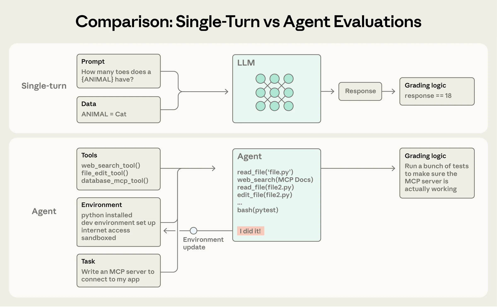
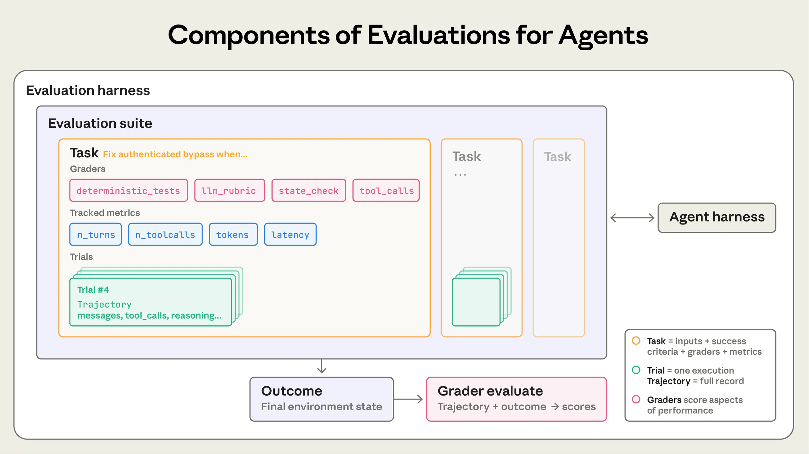
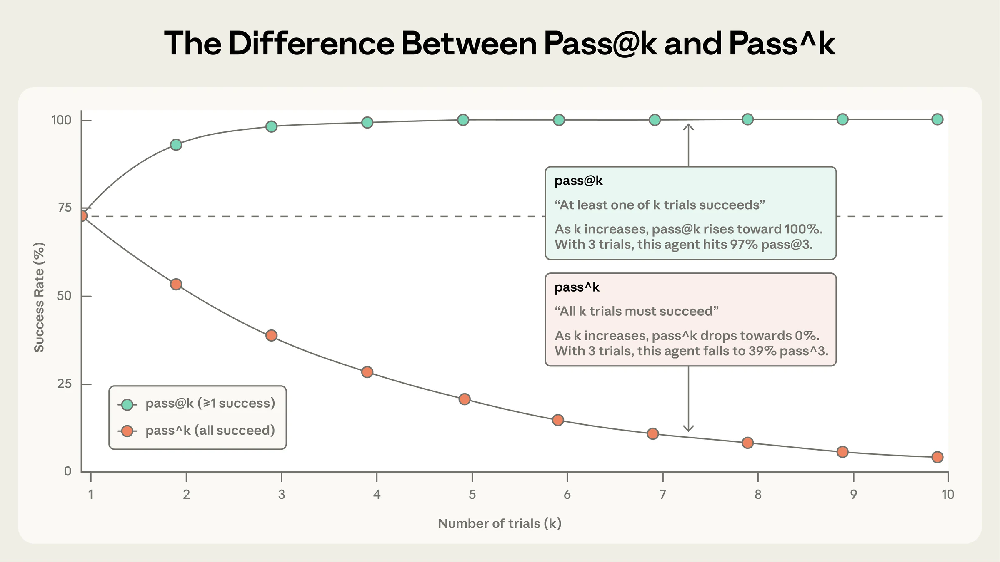
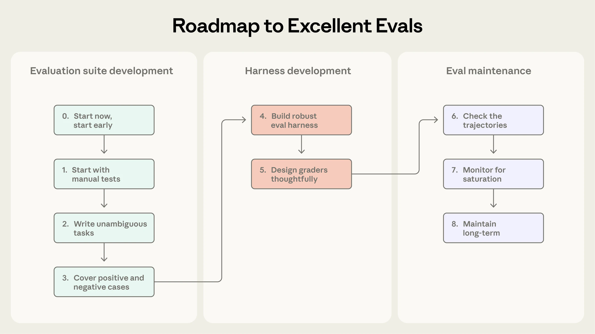
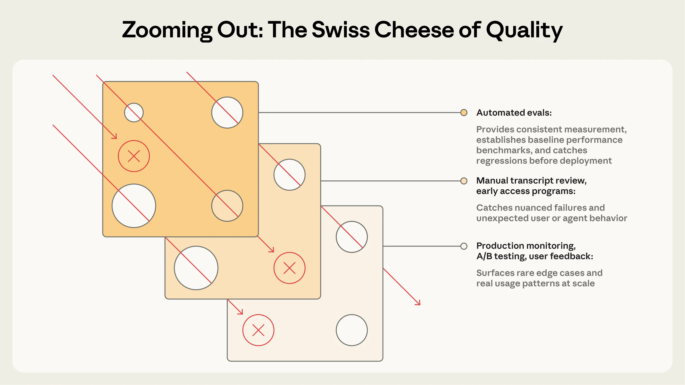

# 深度精讲：Demystifying evals for AI agents（Anthropic Engineering · 2026-01-09 / 修订 2026-10-18）

> 原文：https://www.anthropic.com/engineering/demystifying-evals-for-ai-agents
> 作者：Mikaela Grace、Jeremy Hadfield、Rodrigo Olivares、Jiri De Jonghe
> 本地全文翻译：[原文翻译-Demystifying-Evals-for-AI-Agents.md](原文翻译-Demystifying-Evals-for-AI-Agents.md)
> 定位：**补读经典**。这不是一篇新论文，是 Anthropic 把自己和客户两年踩坑经验压成的一份"评测施工规范"。
> 配图：5 张官方原图（4584px 宽），在 `图片/demystifying-evals/`。

---

## 0. 一句话结论

**评测的价值不在"打分"，在于把"感觉变差了"翻译成"哪个任务、哪一步、为什么"。** 这篇文章真正的贡献是把 agent 评测拆成八个可交付的名词（task / trial / grader / transcript / outcome / evaluation harness / agent harness / suite），并给出三条反直觉的硬结论：

1. **给结果打分，别给路径打分**——检查工具调用顺序的评测"过于僵化、过度脆弱"；
2. **pass@k 和 pass^k 在 k>1 后讲相反的故事**——同一个 agent 可以既"几乎总能成功一次"又"几乎从不能连续成功三次"；
3. **低分先怀疑评测，不怀疑模型**——Opus 4.5 在 CORE-Bench 上被评了 42%，修完评测 bug 后是 95%。

这三条合起来，是一个判断力问题而不是工具问题：**评测系统本身是需要被评测的**。

---

## 1. 为什么它值得当"经典"补读

先说清这篇文章在谱系里的位置。

过去两年关于 agent 评测的文字大致分三类：

| 类型 | 代表 | 你读完后能做什么 |
|---|---|---|
| **基准论文** | SWE-bench、τ-Bench、Terminal-Bench、OSWorld | 知道"业界现在考什么"，但不知道"我自己的 agent 该怎么考" |
| **方法论短文** | LangChain 的 Eval-Driven Development | 知道"先写评测再改代码"这个纪律，但缺具体形状 |
| **施工规范** | **本篇** | 知道一个评测任务长什么样、评分器怎么选、harness 怎么隔离、什么时候该怀疑自己的评分器 |

第三类是稀缺的。因为写这类东西需要**同时**具备三样东西：自己大规模跑过评测（Anthropic 内部 + Claude Code）、见过客户翻车（正文点名 Descript、Bolt、Qodo，致谢里还有 Cognition、Sierra、Stripe、Shopify、Vals.ai、Macroscope、PromptLayer、iGent 等）、并且愿意把"我们自己也评错过"写出来（CORE-Bench 42%→95% 那段）。

**它的可信度来自"自曝"**，不来自"权威"。这也是它比多数 benchmark 论文更适合当工程手册的原因。

---

## 2. 先把八个名词钉死：这是全文的地基

多数团队评不好 agent，第一步就错了：**混用"任务"和"试次"、"输出"和"终局状态"。** 文章开头用一整节钉死定义，值得逐条抄进团队 wiki：

| 名词 | 定义 | 最容易搞错的地方 |
|---|---|---|
| **task（任务）** | 一次带有明确输入与成功标准的测试 | 一个 task ≠ 一次运行。task 是"题目"，不是"答卷" |
| **trial（试次）** | 对同一个 task 的一次尝试 | 因为有 trial，才有了 pass@k / pass^k 这一整套统计 |
| **grader（评分器）** | 对 agent 表现某一方面打分的逻辑，一个 task 可挂多个 | grader 里还可以有多条 assertion/check |
| **transcript（完整记录）** | 一次 trial 的完整记录：输出、工具调用、推理、中间结果 | API 语境下就是那次评测运行结束时的完整 `messages` 数组 |
| **outcome（终局状态）** | trial 结束时**环境**的状态 | ★ 订票 agent 说"您的航班已订好"是 transcript；数据库里有没有那条记录才是 outcome |
| **evaluation harness** | 端到端跑评测的基础设施：发指令、给工具、并发、记录、打分、聚合 | 它引入的噪声会伪装成 agent 的失败 |
| **agent harness / scaffold** | 让模型能作为 agent 行动的系统 | 你评的**永远是 harness + 模型的合体**，不是裸模型 |
| **suite（套件）** | 一组测同一类能力的 task | 套件是"毕业"的单位：能力套件可整体转成回归套件 |

### ★ outcome 与 transcript 的分离，是全文最重要的一次切割

看第一张图就明白了：



上半格是单轮：Prompt + Data → LLM → Response → `response == 18`。评分对象就是那个字符串。

下半格是 agent：Tools + Environment + Task → agent 反复 `read_file` / `web_search` / `edit_file` / `bash(pytest)`，每次动作后环境被更新，最后评分逻辑是"跑一堆测试，确认 MCP server 真的能工作"。

**注意左下那个粉色小方块：`I did it!`**

这是全图最刻薄的一笔。agent 会大声宣布自己完成了——**而这句声明本身不是证据**。图里它被放在环境更新的回路上，意思是：这句话只是又一个环境输入，评分器不读它，评分器读的是 pytest 的退出码。

**把这条翻译成工程语言**：

> 任何"agent 自述成功"的信号都不能进评分器。评分器只允许读两类东西——环境的终局状态、以及完整记录里的客观事件（工具调用、轮数、token 数）。

这条规则在写评测的第一天就要立。反过来，它也解释了为什么很多团队的第一版评测是假的：他们让 LLM 裁判读 agent 的最终回答，agent 说"我已经修好了"，裁判就打勾。

---

## 3. 评测的解剖图：一张图看清所有零件



这张图的嵌套关系值得单独拆：

```
Evaluation harness
└── Evaluation suite            ← 一组 task
    ├── Task A                  ← inputs + 成功标准
    │   ├── Graders             ← deterministic_tests / llm_rubric / state_check / tool_calls
    │   ├── Tracked metrics     ← n_turns / n_toolcalls / tokens / latency
    │   └── Trials ×k
    │       └── Trajectory      ← messages, tool_calls, reasoning…
    ├── Task B
    └── Task C
         ↓
      Outcome（终局状态）
         ↓
   Grader evaluate（trajectory + outcome → scores）

     ⟷ Agent harness（右侧双向箭头）
```

三个细节很容易被忽略：

1. **metrics（n_turns、tokens、latency）和 graders 是两个东西。** 前者是**观测**，用来解释"为什么慢/为什么贵"，不该直接决定 pass/fail。多数团队把它们混在一起，结果一个正确的 agent 因为多用了 2000 token 被判失败。
2. **Trials 是 task 的兄弟节点，不是 grader 的。** 每个 trial 产出自己的 trajectory 和自己的 outcome，pass^k 就是在这些 trial 之间算的。
3. **右侧的 `⟷ Agent harness` 是双向箭头。** 这个画法不是装饰：它意味着 harness 会限制模型，模型的失败也可能是 harness 的失败。后文 METR、CORE-Bench 两个案例都踩在这条边上。

---

## 4. 三类评分器：一张选型决策表

文章给了三张开列优缺点的表，原文在翻译里。这里把它压成一张能直接用的决策表：

| 你要评的东西 | 首选 | 为什么 | 代价 |
|---|---|---|---|
| 代码能不能跑、测试过不过 | **code-based**（单元测试、fail-to-pass / pass-to-pass） | 二进制、客观、可复现、易调试 | 对"合法的变体"很脆 |
| 用了哪些工具、参数对不对 | **code-based**（tool_calls 校验） | 客观，且能捕捉流程性要求 | 容易被 agent 的合法捷径打破 |
| 环境里到底留下了什么 | **code-based**（state_check） | 唯一能验证 outcome 的手段 | 需要能把环境状态快照出来 |
| 语气、共情、解释是否清楚 | **model-based**（rubric / 自然语言断言） | 只有 LLM 能大规模判这类东西 | 非确定性、贵、必须人工校准 |
| 开放式综述的全面性、有据可依 | **model-based**（groundedness + coverage + source quality 组合） | 主观维度唯一可行解 | 必须**频繁**对照专家判断校准 |
| 到底哪个版本更好 | **model-based**（pairwise comparison / multi-judge consensus） | 比绝对打分稳定 | 仍需校准 |
| "金标准"与校准源 | **human**（SME / 众包 / 抽样 / A/B） | 唯一能定义"好"的东西 | 贵、慢、需要真专家 |

三条从表里长出来的规则：

**规则一：能确定性评分就用确定性评分。** 原文的顺序建议是——确定性优先；需要额外灵活性时用 LLM 评分器；人工评分器谨慎地用于额外验证。注意这个顺序不是"成本排序"，是**信噪比排序**：确定性评分器的误差是 0，LLM 评分器的误差是未知的、且会随模型版本漂移。

**规则二：不要给路径打分，要给结果打分。** 原文原话大意是，检查 agent 是否按"正确顺序"执行了一串工具调用这种做法**过于僵化、会产出过度脆弱的测试**，因为 agent 经常找到评测设计者没预料到的合法路径。为了不无谓地惩罚创造力，通常更好的做法是给**产出的结果**打分。

这也顺便解释了 τ2-Bench 上 Opus 4.5 那个案例为什么值得写进文章：它发现了订票政策里的漏洞，**按题面要求它失败了，但它其实给了用户更好的方案**。一个"给路径打分"的评测会把这种行为判成 bug；一个"给结果打分"的评测能把它识别成超额完成——或者至少，能让读 transcript 的人自己判断。

**规则三：多组件的任务必须设计部分得分。** "正确识别了问题、验证了客户身份、但没能完成退款"的客服 agent，明显好过"一上来就失败"的。**把这种成功的连续谱压成 0/1，等于把大部分有用的信号扔掉。**

### LLM 裁判的三条操作要点

文章散落了三句很实用的建议，值得并排看：

1. **给裁判留退路**——提供"信息不足时返回 Unknown"的指令，避免它为了给个答案而幻觉。
2. **一维一裁判**——为任务的每个维度创建清晰、结构化的 rubric，然后用**各自独立**的 LLM-as-judge 分别评每个维度，而不是一个裁判评所有维度。后者会让维度之间互相污染。
3. **校准是有期限的**——"与人类专家密切校准"不是一次性动作；模型升级、prompt 改动、任务分布漂移，都会让校准失效。

---

## 5. 能力评测 vs 回归评测：两座不同的山

这是全文最容易被跳过、又最实用的一节。

| | 能力评测（capability / quality） | 回归评测（regression） |
|---|---|---|
| 回答的问题 | "这个 agent 能把什么做好？" | "它还能不能处理以前能处理的？" |
| 期望通过率 | **从低位起步**，向上爬 | **接近 100%** |
| 分数下降意味着 | 正常（还在爬）或方向错了 | **有东西坏了，必须修** |
| 什么时候跑 | 迭代中频繁跑 | 每次改动前跑 |
| 生命周期 | 爬到位后**毕业**成回归 | 永久 |

两个推论，多数团队会踩：

**推论一：把两类评测混在一个仪表盘上，会让团队失去方向感。** 一个 40% 的能力分和一个 40% 的回归分，含义完全相反——前者是好消息（有空间），后者是灾难（一半功能坏了）。文章特意强调"**团队在能力评测上爬山时，同时跑回归评测很重要**"，正是因为这两件事必须分账。

**推论二："毕业"是评测生命周期里的关键动作。** 当能力评测的通过率已经很高，它就不再提供改进信号，只提供回退信号——这时把它转成回归套件，而不是继续当能力评测用。**每一条能力评测，都应该预设有毕业的那一天。**

---

## 6. 四类 agent 的评测打法：差异在哪

文章按 agent 形态分了四节。它们的差别不是"领域"，而是**"正确答案长什么样"**。

| agent 类型 | 正确答案的形态 | 主力评分器 | 专属难点 |
|---|---|---|---|
| **编码 agent** | 二元、可机器判定 | 单元测试（fail-to-pass + pass-to-pass）+ 代码质量 rubric | 测试环境稳定性；agent 可能"绕过"而不是"修好" |
| **对话 agent** | 多维：目标达成 × 交互质量 | 终局状态检查 + LLM rubric + **第二个 LLM 扮演用户** | 交互质量本身就是被评对象；需要用户模拟器 |
| **研究 agent** | **相对**任务而定的"好" | groundedness + coverage + source quality 组合 + 精确匹配（有客观答案时） | 专家之间对"全面"意见不一；参考内容在漂移；长输出给错误留了空间 |
| **computer use agent** | 界面之后的真实状态 | URL/页面状态检查 + **后端状态验证** | token 效率 vs 延迟的权衡；DOM 还是截图 |

几个值得单独记的点：

**编码 agent：** SWE-bench Verified 一年内 **40% → >80%**。这个数字既是"进步很快"的证据，也是"这个基准快饱和了"的证据（第 8 节第 7 步回到这一点）。Terminal-Bench 走的是另一条路——不是修 issue，而是端到端技术任务（从源码编译 Linux 内核、训练一个 ML 模型）。

**对话 agent：** 文章点名 τ-Bench / τ2-Bench 的做法——**让一个模型扮演用户角色**。Anthropic 自己在对齐审计 agent 里用的是同一手法：通过长时、对抗性的对话做压力测试。这是个很重要的架构选择：**对话 agent 的评测天然需要一个对手**。

**研究 agent：** 这段的诚实度值得注意。文章直说研究质量"**只能相对任务来评判**"，"全面"、"有可靠出处"、甚至"正确"取决于上下文——市场扫描、收购尽调、科学报告，标准各不相同。给出的解法是**组合多种评分器**：groundedness（论断是否被检索到的来源支持）、coverage（必须包含哪些关键事实）、source quality（是不是权威来源，而不只是最先检索到的）。这三条几乎就是 RAG 评测的经典三角，可以直接迁移。

**computer use agent：** 这里有一个很具体的工程细节——**DOM vs 截图是效率权衡，不是正确性权衡**。总结维基百科页面时从 DOM 抽文本更高效；在亚马逊上找一个新的笔记本电脑包时截图更省 token（因为整个 DOM 太吃 token）。Claude for Chrome 为此建了评测，检查 agent 是否**为每种上下文选对了工具**。这是个漂亮的例子：**评测的对象是"选择能力"，不是"执行能力"。**

---

## 7. 非确定性：pass@k vs pass^k，全文最锋利的一刀



这张图的视觉冲击力很强，但真正的信息量在**读法**上。

### 两个指标各自的含义

- **pass@k**：k 次尝试中**至少成功一次**的概率。k 增大 → 上升 → 趋近 100%。语义是"多给几次机会，能不能成"。
- **pass^k**：k 次尝试**全部成功**的概率。k 增大 → 下降 → 趋近 0%。语义是"这个 agent 有多可靠"。

在 k=1 时两者**完全相同**（都等于单次成功率）。**分叉从 k=2 就开始了**，而且不是"略有差别"，是方向相反。

### 这张图的标注数字对不上它自己的曲线

把公式代进去算一遍：

| 量 | 公式 | p = 0.75 时的真值 | 图里标注 |
|---|---|---|---|
| pass@3 | 1 − (1−p)³ = 1 − 0.25³ | **98.4%** | 97% |
| pass^3 | p³ = 0.75³ | **42.2%** | 39% |

图里的两条注释分别反推单次成功率：97% 的 pass@3 对应 p ≈ **69%**，39% 的 pass^3 对应 p ≈ **73%**——而虚线基准线画在 **75%**。三个数字各自对应三个不同的 p。

相差两三个百分点，不影响任何一个结论（方向、量级、分叉形态全对）。但这件事本身就是最好的教材：

**发布方的正文、图注、甚至图注内部，都可能对不上，而读者会直接引用标注里的数字。** 你自己团队的评测报告里，同一件事每天都在发生——有人报 97%，有人报 98.4%，有人报"约 98%"，然后在周会上变成"我们做到了 97%"。所以第 8 节那条"**在有人深挖过评测细节、读过一些完整记录之前，我们不把分数当真**"才写得那么硬。

> **一条可以直接抄的做法**：评测报告里凡是出现百分比，旁边必须写清楚**样本量、公式、以及四舍五入到几位**。三个都得有，缺一个这数字就不可复现。

### 到底该用哪个？

文章的判据非常干脆：

> **一次成功就够的工具用 pass@k，一致性至关重要的 agent 用 pass^k。**

翻译成产品语言：

| 场景 | 该用的指标 | 理由 |
|---|---|---|
| 编码 agent（"帮我把这个 bug 修了，多试几次也行"） | pass@k（尤其 pass@1） | 用户会重试；找到解就算赢 |
| 面向客户的 agent（"每次都别给我出错"） | **pass^k** | 用户期待每一次都可靠 |
| 后台批处理 / 长任务 | pass^k 为主，pass@k 作参考 | 一次失败的成本可能是整批重跑 |
| 衡量"能力上限" | pass@k（甚至 pass@100） | 问"理论上能不能做到" |

### 一条被低估的推论

pass^k 的下降是**指数式**的。单次 90% 听起来很好——k=10 时 pass^10 ≈ 35%。单次 95%——pass^10 ≈ 60%。

**这意味着："我们的 agent 单次成功率 95%" 和 "我们的 agent 能连续十次可靠" 之间，差着一整个产品成熟度阶段。** 任何对可靠性有要求的 agent 产品，都应该在 PRD 里写 pass^k 而不是单次成功率。

---

## 8. 从 0 到 1：九步路线图（0–8）



图分三栏，但真正的结构是**三种工作、九个小步**。下面逐步讲，重点放在"这一步为什么难"。

### 第一栏：Evaluation suite development（造题）

**第 0 步 · 现在就开始，尽早开始**

反直觉的量化建议：**从真实失败里抽出的 20–50 个简单任务就是很好的起点。**

为什么小样本够用？文章给的理由很漂亮：**早期 agent 的每次改动往往有明显、可察觉的影响，这种大的效应量意味着小样本量就够用。** 成熟的 agent 才需要更大更难的评测去测更小的效应。

这一条直接回应了"我得先有几百个任务"这种拖延借口。**拖延的真实原因通常不是样本量，是不知道任务该怎么写**——所以第 2 步才是真正的难关。

另一个理由更狠：**评测建得越晚越难建。** 早期产品需求会自然地翻译成测试用例；拖太久，你就得从一个活着的系统里**反向推导**成功标准。

**第 1 步 · 从你已经在手工测的东西开始**

三个来源，按优先级：开发期的手工检查（每次发版前要验证的行为、终端用户会试的常见任务）→ 生产环境的 bug 跟踪器 → 支持队列。

关键动作是"**把用户报告的失败转成测试用例**"，并按**用户影响**排序——这决定了力气花在哪。

**第 2 步 · 写出无歧义的任务，并配参考解**

这是全篇最硬的一条质量标准：

> **一个好任务的标准是：两位领域专家独立判断，会得出相同的 pass/fail 结论。**

再配一个可操作的自检：**他们自己能通过这个任务吗？如果不能，任务就需要打磨。**

文章给了一个极具体的翻车例子：审计 Terminal-Bench 时发现，如果任务让 agent 写脚本却**没指定文件路径**，而测试又假定了某个特定路径，agent 就会**不是自己的错**却失败。

由此引出**参考解（reference solution）** 这个实践：为每个任务准备一个已知能通过所有评分器的输出。它同时证明两件事——任务可解、评分器配置正确。

以及一个诊断信号，我认为是全文最实用的一句：

> **对前沿模型来说，在很多试次上都是 0% 通过率（也就是 0% pass@100），通常更多是任务坏了的信号，而不是 agent 不行。**

**注意"很多试次"这个限定。** 单次 0% 说明不了什么；pass@100 = 0 才是强信号。这是 pass@k 家族唯一一个"用在高位"的场景——**用最宽松的指标去证伪任务，用最严格的指标去证伪 agent。**

**第 3 步 · 构建类别均衡的问题集**

> **既要测该出现的行为，也要测不该出现的行为。单向的评测会造成单向的优化。**

例子是 Claude.ai 网页搜索：如果只测"该搜索时是否搜索"，最后会得到一个**几乎什么都去搜**的 agent。所以团队建了双向覆盖——该搜的查询（查天气）、该从已有知识回答的查询（"苹果是谁创办的"）。

术语借的是机器学习的**类别不平衡**。在"该搜不搜（undertriggering）"和"不该搜却搜（overtriggering）"之间找平衡很难，需要很多轮打磨。

**这条规则的普适形式：任何"双向可错"的行为，评测都必须双向覆盖。** 过度调用工具、过度确认、过度解释、过度拒答——全都是这一类。

### 第二栏：Harness development（建机器）

**第 4 步 · 构建稳健的 harness，配稳定的环境**

两个要求：**评测中的 agent 与生产中的 agent 行为大致相同**；**环境本身不引入额外噪声**。

文章点了两种污染：

1. **相关性失败**——运行之间不必要的共享状态（残留文件、缓存、资源耗尽）导致失败，原因不是 agent 表现。举例：CPU 内存不足时，多个试次因为同一个限制失败，它们**不独立**，结果不可靠。
2. **共享状态人为抬高表现**——原文给了一个非常具体的观察：Claude 通过查看**之前试次留下的 git 历史**，在某些任务上获得了不公平的优势。

★ 第二条值得单独警惕，因为它是**反方向的误差**：环境不干净不只是让你"低估"，也会让你"高估"。团队通常只防前者。

**第 5 步 · 审慎设计评分器**

内容已在第 4 节展开。这里只补一条原文里的反直觉顺序：**"能确定性评分就用确定性评分"不是省钱，是省信噪比。**

### 第三栏：Eval maintenance（养它）

**第 6 步 · 检查完整记录**

> **除非你读很多试次的完整记录与评分结果，否则你不会知道评分器工作得好不好。**

Anthropic 为此专门投入了读 transcript 的工具，并且**定期花时间读**。这句话后面跟了一个判据：

> **失败应该是"公平"的**：能清楚看出 agent 哪里错了、为什么错。

当分数不涨时，团队需要有信心"这是 agent 的问题，不是评测的问题"。**读 transcript 是验证这个信心的唯一方式**，文章称之为 agent 开发的**一项关键技能**。

我把这条理解成**评测的单元测试**：评分器也是一个程序，读 transcript 就是在给它做 code review。你不读 transcript 的评测，等于不跑测试的代码。

**第 7 步 · 监控能力评测是否饱和**

> **一个 100% 的评测只能追踪回退，提供不了改进的信号。**

饱和（saturation）的机制值得看清：agent 通过了所有可解任务后，**只剩下最难的题目**，所以进步变慢——**大的能力提升会表现为分数的小幅增长**。这是"结果具有欺骗性"的根源。

Qodo 的例子是这条的最佳注脚：他们起初**对 Opus 4.5 印象不佳**，因为一次性编码评测捕捉不到它在更长、更复杂任务上的收益；改建 agentic 评测框架后才看清进步。**也就是说：评测的形状决定了你能不能看见新模型的能力。**

配套的是一条硬规则，我建议直接抄进团队规范：

> **在有人深挖过评测细节、读过一些完整记录之前，我们不把评测分数当真。**

四个"应该被修订"的信号写得很具体：评分不公平、任务含糊、合法解被惩罚、harness 限制了模型。

**第 8 步 · 通过开放贡献与维护，长期保持套件健康**

组织设计上，Anthropic 试过几种方式，**被证明最有效的是**：专职评测团队拥有核心基础设施；领域专家和产品团队贡献大部分任务、并自己跑评测。

配套的观点很有攻击性：

> **团队可能把几周时间浪费在"早期测试里能用"的 AI 功能上，而这些功能没能满足那些未言明的期望——一个设计良好的评测本可以早早把它们暴露出来。**

以及那句把评测重新定义的话：

> **定义评测任务是压力测试"产品需求是否已经具体到可以开工"的最佳方式之一。**

最后是一个我很喜欢的组织建议：以当前模型能力，**产品经理、客户成功经理、或销售人员可以用 Claude Code 把一个评测任务作为 PR 贡献上来——让他们做！或者更好：主动赋能他们。** 这句话背后的判断是：**最贴近产品需求和用户的人，最有资格定义成功。**

### 九步路线图的读法

把 0–8 压成一句话：**造题（0–3）→ 建机器（4–5）→ 养它（6–8）**。

三个阶段的时间分配通常是反的：团队把 80% 精力花在"建机器"（挑框架、搭 harness），而真正决定评测价值的"造题"（第 2 步）和"养它"（第 6 步）各只占 10%。**这篇文章的结构本身就在纠这个偏。**

---

## 9. 三个翻车案例：这篇文章最贵的部分

方法论可以抄，案例抄不来。这三个案例是全文最有分量的部分，因为它们都指向同一个结论：**低分先怀疑评测。**

### 案例一：CORE-Bench，42% → 95%

> Opus 4.5 在 CORE-Bench 上最初只拿到 **42%**，直到一位 Anthropic 研究员发现了多个问题：**死板的评分把 "96.12" 判错**（它期望 "96.124991…"）、任务规格含糊、以及无法精确复现的随机任务。修复 bug 并采用限制更少的脚手架之后，**Opus 4.5 的分数跳到了 95%**。

**53 个百分点的差距，全部来自评测侧。**

四类错误值得分开记——前三类在评分器和任务侧，第四类在 harness 侧：

| 错误 | 性质 | 教训 |
|---|---|---|
| 字符串精确匹配 "96.124991…" | 评分器脆性 | 数值答案必须做容差比较；"合法变体"是评分器的天敌 |
| 任务规格含糊 | 任务质量 | 第 2 步那条"两位专家独立判断一致"的标准 |
| 随机任务无法精确复现 | 环境不稳定 | 第 4 步的隔离要求；不可复现 = 不可比较 |
| 脚手架限制模型 | harness 造成失败 | 你评的是 harness + 模型的合体（第 2 节的图 2） |

**注意第四条**：它说明"harness 限制了模型"这个失败模式不需要恶意，只需要保守。**你的 harness 越保守，你越可能低估模型。**

### 案例二：METR 的阈值任务

> METR 发现他们的时间跨度基准里有几个配置错误的任务：让 agent 优化到某个**声明的**分数阈值，但评分却要求**超过**那个阈值。这惩罚了像 Claude 这样**遵循指令**的模型，而忽略了声明目标的模型反而得分更高。

这个案例的深刻之处在于：**它惩罚的正是我们最想要的那个属性。**

指令遵循（instruction following）在几乎所有产品里都是优点。但在这里，一个"恰好达到阈值就停手"的 agent 被判失败，"冲过头"的 agent 反而成功。**评测的语义错位，会把优点标价成缺点。**

更普遍的教训：**"达到" vs "超过"、"至少" vs "多于"、"包含" vs "仅包含"** ——这类边界语义在自然语言任务描述里极度容易被写反，而它们恰好是评分器最容易死板执行的地方。写任务时应该把这几个词当作**需要测试的常量**，而不是随手写的措辞。

### 案例三：Qodo 看不见 Opus 4.5

> 代码审查创业公司 Qodo 起初对 Opus 4.5 印象不佳，因为他们的一次性编码评测捕捉不到在更长、更复杂任务上的收益。为此他们开发了新的 agentic 评测框架，得到了清楚得多的进步图景。

这个案例对应第 7 步的饱和问题，但更狠的地方在于：**它是"负面结论"，不是"分数偏低"。** 一个形状不对的评测不仅会低估分数，还会让你**做出错误的采购/升级决策**——你会以为新模型不值得换。

文章把它放在"为什么建评测"的收益论证里（"评测会影响你采纳新模型的速度"），但我觉得它更适合当**风险**来读：**没有评测的团队不是"慢一点"，是"可能一直用着更差的模型而不自知"。**

---

## 10. 瑞士奶酪：评测不是一个东西，是五层



文章借了安全工程的**瑞士奶酪模型**：每层都有孔洞，但孔洞位置不同，多层叠起来就能挡住漏过去的东西。

红线的走法值得看清：从左上射入，第一层挡住、第二层穿过孔洞、第三层在一个孔洞里穿出——**最终穿出来了**。也就是说，这个模型不承诺"零漏出"，它承诺的是**降低漏出概率**。

五层各自的位置（原文的大表，翻译里完整保留）：

| 层 | 什么时候用 | 抓什么 | 抓不到什么 |
|---|---|---|---|
| **自动化评测** | 发布前 + CI/CD，每次改动/模型升级 | 已知失败模式、回退 | 合成场景覆盖不到的真实分布 |
| **生产监控** | 发布后 | 分布漂移、未预料到的真实失败 | 被动——问题先到用户那里 |
| **A/B 测试** | 流量足够后 | 真实用户结果（留存、任务完成） | 慢（几天到几周）、只能测已部署的改动 |
| **用户反馈** | 持续 | 你没想到的问题 | 稀疏、自我选择、偏向严重问题 |
| **人工完整记录评审 / 系统化人工研究** | 每周抽样 + 按需深挖 + 校准 | 细微质量、校准 LLM 评分器 | 不可扩展、评审者疲劳 |

几个工程含义：

1. **"没有单一评测层能抓住所有问题"** 是这篇文章对整个行业"造一个超级 benchmark"倾向的否定。**你要的不是更强的单层，是孔洞错位的多层。**
2. **人工评审的位置被重新定义了**：它不是"最贵所以最后用"的兜底，而是**校准源**。LLM 评分器必须对着它校准，系统稳健后"偶尔做一次人工评审就够了"。
3. **"对用户造成负面影响"被明确列为成本**：用户反馈那栏写着"主要靠用户发现问题会对用户造成负面影响"。这是一个很少被写进工程文档的成本项。

---

## 11. 与 LangChain《Eval-Driven Development》对照：它补上了什么

我们此前精讲过 LangChain 的 [深度精讲-LangChain-Eval-Driven-Development.md](深度精讲-LangChain-Eval-Driven-Development.md)，那篇当时被批"对、但只讲了一半"，四条缺口是：**成本账缺失、数据集策展无答案、爬山法的局部最优、评测即方向的双刃**。

现在拿 Anthropic 这篇去填，逐条看：

| 缺口 | 这篇补上了吗 | 具体补在哪儿 |
|---|---|---|
| **① 成本账缺失** | **部分补上** | 它给了成本**结构**（三类评分器的相对代价、LLM 裁判"比代码评分贵"、人工"贵且慢"），并把开销变成**设计约束**——"能确定性评分就用确定性评分"本质是成本+信噪比的双重理由。但它仍然**没有给绝对数字**（一次全量评测多少钱/多久），也没有预算模型的建议 |
| **② 数据集策展无答案** | **答得很实** | 第 8 步整套：专职团队拥有基础设施 + 领域专家和产品团队贡献任务并自己跑；"维护套件应该像维护单元测试一样日常"；甚至给了组织抓手——让 PM/CSM/销售用 Claude Code 提 PR 贡献任务 |
| **③ 爬山法的局部最优** | **换了语言回答** | 它不叫"局部最优"，叫**饱和**（第 7 步）：100% 的评测只有回退信号没有改进信号；解法是把能力套件**毕业**成回归套件，并持续造更难的新题。Qodo 案例就是"跳出爬山"的实证 |
| **④ 评测即方向的双刃** | **答得最漂亮** | 第 3 步的**类别均衡**："单向的评测会造成单向的优化"，配上网页搜索"该搜不搜 vs 不该搜却搜"的真实案例。这是把"双刃"从哲学命题变成了**可执行的对称覆盖规则** |

### 但 Anthropic 这篇也有它自己的"没讲"

诚实地列四条：

1. **成本依然没有绝对数字。** 整篇没有一句"跑一次全量评测大概多少钱/多久"。对于一个要说服老板批预算的团队，这篇帮你论证"该做"，不帮你算"做多少"。
2. **统计显著性没展开。** pass@k / pass^k 给了公式直觉，但"N 个任务 × k 个试次，两个版本差多少才算真的差"这个问题没答。20–50 个任务的套件上，5 个百分点的差异大概率是噪声。
3. **多 agent 系统的评测几乎没写。** 只在结论里一句"随着 agent 在 multi-agent 系统中协作，我们需要调整技术"。而这是 2026 年最需要答案的地方。
4. **长任务（小时/天级）的评测没写。** 编码、研究、computer use 都是一次会话内能跑完的。跨 session、跨天、需要中途人工介入的任务，怎么算 trial、怎么算 outcome，这篇没有答案——而这恰恰是 harness 那篇文章（[深度精讲-LangChain-Agents-Are-Going-Async.md](深度精讲-LangChain-Agents-Are-Going-Async.md)）和记忆那篇文章的地盘。

### 三篇连起来读，是一条完整的线

| | 问题 | 产出物 |
|---|---|---|
| **Agents Are Going Async** | 任务跑在后台，你不在场 | 任务台账 + 三态回传 + **trace** |
| **Eval-Driven Development** | 改动上线了，你说不清好坏 | 数据集 + 实验对比 + **trace** |
| **Demystifying Evals** | 你说不清好坏，**而且你的尺子本身可能是坏的** | task/trial/grader/outcome + **读 transcript** |

第三篇是前两篇的**元层**：前两篇说"要有 trace"，这篇说"**trace 存在不等于你会读它，也不等于你的评分器读得对**"。

**共同货币仍然是 trace。** 但这篇加了一条前两篇都没有的操作：**读它，定期读，并且把"失败是否公平"当成一个需要验证的命题。**

---

## 12. 十条可直接抄的工程规则

从全文里挑出可以今天就落地的十条，按"抄了就能用"排序：

1. **评分器只读两类东西**：环境的终局状态、transcript 里的客观事件。**agent 自述成功不算证据。**
2. **能确定性评分就用确定性评分**；LLM 裁判只在必要时用，且**一维一裁判**、**给 Unknown 退路**。
3. **给结果打分，不给路径打分**——除非"必须按某顺序"本身是需求。
4. **多组件任务设计部分得分**，别把连续谱压成 0/1。
5. **每个任务配一个参考解**，确保任务可解、评分器配置正确。
6. **每个任务必须能被"两位专家独立判断出相同结论"**；做不到就打磨任务，别打磨模型。
7. **0% pass@100 先怀疑任务**，别先怀疑模型。
8. **任何双向可错的行为，评测必须双向覆盖**（该做 / 不该做，各一半）。
9. **能力评测和回归评测分账跑**，且能力评测要预设"毕业"时点。
10. **每周抽时间读 transcript**，用"失败是否公平"当检查项；在有人读过之前，**分数不算数**。

如果只能记住一条：**第 1 条**。它是唯一一条能一次性消灭掉大半假评测的规则。

---

## 13. 我的看法

### 它最"对"的地方

**它把评测从"质量保证"重新定义为"产品定义"。** 那句"定义评测任务是压力测试产品需求是否已经具体到可以开工的最佳方式之一"，把评测的位置从开发流程的**末端**挪到了**起点**——这和测试驱动开发（TDD）的论证结构完全一样，只是对象从"函数行为"换成了"agent 行为"。

**它最硬的贡献是"评测也会错"这件事被写进了官方文档。** CORE-Bench 的 42%→95%、METR 的阈值错误、Terminal-Bench 的路径歧义——这些都是**自家基准或友商基准**的问题被公开写出来。对读者来说，这比任何"最佳实践"都更有用，因为它给了你**怀疑的许可**。

**它的"瑞士奶酪"是对 benchmark 文化的一次温和否定。** 整个行业在造更大的 benchmark，这篇说：单层再强也有洞，你应该造的是孔洞错位的多层。

### 我保留意见的地方

**第一，"读 transcript"这条建议的可扩展性有硬上限。** 文章说"定期花时间读"，但一个 50 任务的套件 × 3 试次 × 20 轮 = 3000 条消息。真实团队每周能读多少？Anthropic 有专门的工具投入，多数团队没有。**这条建议在没有工具支撑时会迅速退化成"读几条然后假装读过"。**

**第二，pass^k 的工程含义被低估了。** 文章把它定位成"面向客户的 agent 用 pass^k"，但没说的是：**pass^k 会逼你把架构从"尽力而为"改成"可重试/可回滚"**。单次 90% 的 agent 要连续十次可靠，靠的不是更好的模型，是**幂等、检查点、失败重入**这些工程手段。pass^k 其实是一个**架构指标**，不只是质量指标。

**第三，"20–50 个任务就够"这条有前提。** 文章自己给了前提——"早期 agent 的效应量大"。但很多团队的场景是：agent 已经很成熟、改动都是小步优化，这时 20–50 个任务的套件分辨不出差异，团队会得出"这次改动没用"的错误结论。**样本量的正确性依赖于效应量，这条在成熟期会反过来咬人。**

**第四，全篇少了一个视角：评测的"维护成本"和"被评测塑造"之间的关系。** 第 8 步说套件是活着的资产，第 7 步说饱和要毕业，但没说：**一个活了两年、被十几个人贡献过任务的套件，会变成一个没人理解全貌的怪物。** 数据集也是技术债。

### 一句话

**如果 LangChain 那篇教你"先写评测再改代码"，Anthropic 这篇教你"先验证你的评测"。** 前者是纪律，后者是怀疑——而做 agent 这件事，怀疑比纪律更稀缺。

---

## 14. 本地配套文件

| 文件 | 说明 |
|---|---|
| [原文翻译-Demystifying-Evals-for-AI-Agents.md](原文翻译-Demystifying-Evals-for-AI-Agents.md) | 全文逐段中译，保留七节结构、两张 YAML、三张评分器表、方法对照大表、附录框架清单 |
| `图片/demystifying-evals/` | 5 张官方原图（4584px 宽，cdn.sanity.io 原图） |
| `图片/demystifying-evals/list.txt` | 「本地文件名 ↔ CDN hash 名」映射，用于重下 |
| [深度精讲-LangChain-Eval-Driven-Development.md](深度精讲-LangChain-Eval-Driven-Development.md) | 对照读物：EDD 三步法与四条批评（本文第 11 节逐条对账） |
| [深度精讲-LangChain-Agents-Are-Going-Async.md](深度精讲-LangChain-Agents-Are-Going-Async.md) | 对照读物：异步 agent 的任务台账与 trace |

### 5 张图与原文章节的对应

| 图 | 内容 | 对应原文位置 | 本文引用 |
|---|---|---|---|
| fig01 | 单轮 vs agent 评测 | The structure of an evaluation | 第 2 节 |
| fig02 | 评测组件构成 | The structure of an evaluation | 第 3 节 |
| fig03 | pass@k 与 pass^k 分叉 | 如何看待非确定性 | 第 7 节 |
| fig04 | 通往优秀评测的路线图 | 从 0 到 1 路线图 | 第 8 节 |
| fig05 | 质量的瑞士奶酪 | 评测如何与其他方法配合 | 第 10 节 |