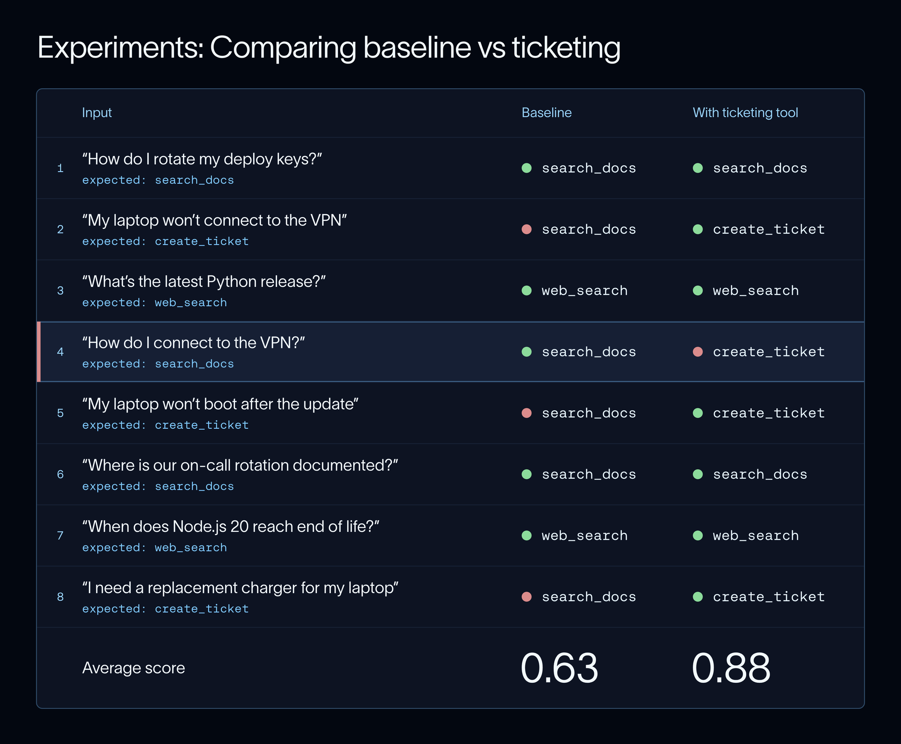

# 深度精讲：《What Is Eval-Driven Development?》——当 agent 的「进步」不再肉眼可见

> **原文**：What Is Eval-Driven Development? How to Improve AI Agents · Divya Santhanam · LangChain Blog · 2026-11-09 · 10 min
> https://www.langchain.com/blog/what-is-eval-driven-development
> **配套**：全文翻译见同目录 `原文翻译-LangChain-Eval-Driven-Development.md`；六张官方配图已下载到 `图片/eval-driven-development/`。

---

## 0. 先看结论（如果只读 60 秒）

**一句话**：这篇文章讲的不是"怎么用 LangSmith"，而是**"当 agent 复杂到你已经看不出它变好还是变坏时，团队该靠什么做决策"**——答案是：把口语化的直觉换成一套可复现的、能判 pass/fail 的评测集，并让每一次改动都变成一次可对比的实验。

五条硬结论：

1. **EDD 复刻的是 TDD 的骨架，但换掉了"测试"这个零件**。TDD 的前提是确定性；agent 有输出飘、多解都对、步数自选三重非确定性，所以要用"评分"取代"断言"。
2. **规格要窄到能 pass/fail**。原文的四段式（When / Do / Don't / Keep intact）是整篇最可直接抄走的东西——尤其 **"Keep intact"**，绝大多数团队漏的就是这一栏，而它是防回退的唯一防线。
3. **评测要在动手之前写，而且要确认它在当前坏版本上失败**。这是 TDD 的"红"阶段；跳过它，你写的评测很可能只是**给已有输出背书**。
4. **真正的改进信号不是平均分，而是逐条样例的迁移矩阵**。原文作者的示范非常诚实：加工具后平均分 0.63 → 0.88，同时**弄坏了一条**——`How do I connect to the VPN?` 从"查文档"变成"开工单"。
5. **失败要变成资产**。CI 里跑、线上采样跑、失败回流成数据集样例——否则你的评测集永远停在"开发时想到的那些情况"。

**这篇文章的可信之处**：03 那一步作者没有停在全绿，而是主动警告"小数据集上 100% 往往是过拟合"，并给出留出集的判据。一篇厂商博客愿意写"我的满分不可信"，比它写十段功能说明都有价值。

**这篇文章没说的**：钱、时间、人。谁来标 200 条黄金数据？LLM 裁判每天采样 5% 的成本是多少？这些决定 EDD 能不能落到小团队身上，而原文默认你有 LangSmith 和一个愿意看 trace 的人。

---

## 1. 它到底在解决什么问题：三种非确定性的三种后果

原文列的三条非确定性，值得逐条推演——因为它们决定了评测**必须**怎么设计：

| 非确定性 | 对"测试"的破坏 | EDD 的应对 |
|---|---|---|
| **输出会变**（同一问题两次答案不同） | 断言式测试天然不成立 | 用**统计意义上的通过率**，而不是一次运行 |
| **多解都对**（措辞不同都算对） | 精确匹配会把正确答案判错 | **LLM-as-a-judge**，或用"关键属性"而非全文匹配 |
| **步数自选**（该用的工具没用、不该用的用了，却仍答对） | 只看最终答案会漏掉过程错误 | **评中间步骤 / 工具序列 / 多轮 thread** |

第三条是最容易被低估的。它意味着**"答案对了"不等于"行为对了"**——一个在生产环境里能碰巧给出正确答案的 agent，可能正在用一堆危险的临时手段。原文的 docs agent 例子恰好反过来展示了同一件事：答案看起来合理（"I've filed ticket IT-4821…"），但**动作是错的**。

> 这也是这篇文章与「Agent 人机审批」主题的暗接口：过程可观察，才谈得上过程可审批。

---

## 2. 三步法拆解

### Step 1 · 定义"好"：PRD → 一次一个行为 → 四段式 spec

原文给的路径是：**行为清单（PRD）→ 挑一个行为 → 写四段式 spec**。

为什么"一次一个行为"？原文的说法是"避免一处改动混淆另一处的效果"。用更直白的话说：**EDD 是单变量实验法**。你同时改工具描述、系统提示和模型，评测集分数动了你也不知道是谁的功劳——这和 A/B 测试的基本纪律是同一条。

四段式 spec 的四栏，各自对应一种失败：

| 栏位 | 防的是什么 | 缺失后果 |
|---|---|---|
| **When**（何时触发） | 该做时不做（漏触发） | 覆盖率永远测不出来 |
| **Do**（要做什么） | 做了但动作错 | 只测结果就完全看不见 |
| **Don't**（不要做什么） | **过度触发** | 这是本次案例里真正翻车的地方 |
| **Keep intact**（必须保持） | **回退** | 加了新功能，旧功能静默坏掉 |

`Don't` 与 `Keep intact` 是这篇文章的精华。前者是**边界**，后者是**回归测试**——传统软件工程里这两件事早就分得很清楚，而 agent 团队常常只写 `Do`。

再看作者的例子设计，有一个很关键的细节：**"我们要按照这几条来评测，即使 agent 目前还没有这个能力"**。这就是 TDD 的"先写失败测试"：spec 先落地，能力后补，评测集在动手之前就已经是**红**的。这样做的好处不只是纪律，而是**基线实验有了可比的意义**。

### Step 2 · 先写评测：数据集 × 评测器 × 基线

**数据集的三条来源**，按可信度排序：

1. **真实运行记录**——原文最强的一句话在这里：*"如果你的样例看起来像真实流量，那么在你评测上拿到好分数，就更可能意味着线上行为也真的好。"* 这句话是**外部效度**的通俗表述：评测集与生产分布的偏差，就是评测与现实的偏差。
2. **人工构造**——没有运行记录时的替代，代价是分布偏移（你会写出自己想到的那些问法）。
3. **合成扩增**——把已有样例交给 LLM 改写（原文例子：把消息改写成更生气的语气），补足稀疏的情绪/语气维度。

第三条有个隐含风险原文没有展开：**合成数据会继承模型自身的偏差分布**。你把样例交给同一个模型家族去"变着说法重写"，很可能只覆盖了"那个模型会想到的说法"。所以合成扩增适合**补充维度**（语气、长度、错别字），不适合**发现新维度**。

**评测器：代码 vs LLM 裁判**。原文给的判据是"确定性用代码，非确定性用裁判"，够用但不完整，补一个实操版的判断表：

| 你要检查的东西 | 推荐方式 | 备注 |
|---|---|---|
| 调用了哪个工具 / 参数是否合法 | **代码** | 本例即此 |
| 最终状态（文件、数据库、沙箱） | **代码 + 干净环境** | 见下文 Harbor |
| 答案是否覆盖关键事实（RAG 型） | 代码（关键点匹配）或裁判（带 rubric） | 混合最稳 |
| 语气、有帮助程度、完整性 | **裁判** | 必须先与人类对齐 |
| 多步推理是否走了捷径 | **裁判 + trace 人工抽检** | 纯自动化目前不可靠 |

**"检查环境留下的状态"**这段是全文最容易被跳读、但工程含量最高的一段。原文的论证链是：

> 如果 agent 会**改变环境**（编码 agent、运维 agent）→ 检查几次工具调用和最终回复**不够** → 必须检查**最终状态** → 而状态可检查的前提是**每次运行都有干净环境**。

这条链把"评测"从"打分"变成了"**可复现实验平台**"的问题。也正因为如此，原文才引入 **Harbor**（开源框架，Terminal-Bench 背后的 harness）：**每个任务一个沙箱 + 一个给最终状态打分的测试脚本**。

顺带说一句产品层面的观察：LangChain 用 Harbor 做了一件很漂亮的事——**用评测来判断能不能删掉代码**。原文："它也告诉我们能否砍掉 harness 的某些部分，比如 todo-list middleware 或系统提示的一部分，而不让 agent 变差。"这是评测的第二重价值：不只是"改对方向"，而是**给出删减的许可**。大多数团队只把评测当"守门员"，而它其实还是"预算审计员"。

**基线（baseline）**：原文对 baseline 的用法是"改动之前先跑一次，作为对比度量"。这里隐藏一条纪律：**baseline 必须与后续实验用同一份数据集、同一套评测器、同一个模型配置**。否则对比就是噪音。原文例子里的 baseline 5/8 很妙——它同时记录了"3 条待实现"和"5 条已工作"，后者就是**天然的回归集合**。

### Step 3 · 改动与对比：爬山、回归、看 trace

**爬山（hill climbing）**这个词选得很准：它承认这是个**局部搜索**问题——你在当前策略附近小步试探，接受让分数上升的改动，拒绝让分数下降的改动。它意味着两件事的代价你必须接受：

- 你**可能卡在局部最优**（比如永远在调工具描述，而不去改 agent 的分解策略）；
- 你的**改进速度受限于实验吞吐**（每个假设一次全量实验）。

**案例解剖：这次翻车非常典型。**

- 改前：`create_ticket` 不存在 → 三条工单类请求落到 `search_docs` → 失败。合理。
- 改后：加了工具 → 三条都对了 → **但**"How do I connect to the VPN?" 也去开工单了。
- 平均分 **0.63 → 0.88**，看起来是一次漂亮的提升。
- 病根在 **工具描述**：`"Files an IT support ticket. Use for VPN and laptop issues."`——**它把"VPN"当成了触发词，而用户的问题里恰好也有"VPN"**。
- 修复：把描述收窄到"需要 IT 出手的请求"→ 8/8。

这个案例值得反复讲，因为它同时展示了三件事：

1. **语义相似 ≠ 意图相同**。"连不上 VPN"与"怎么连 VPN"共享几乎所有关键词，只在"坏了 vs 怎么用"这一层不同。工具描述用**名词触发的写法**（VPN、laptop）而不是**意图触发的写法**（需要 IT 出手），必然过宽。
2. **平均分是一种掩盖机制**。+0.25 的平均分提升背后，是"3 条由坏变好 + 1 条由好变坏"。如果只看总分会直接合并上线，然后某天客服说"我们收到了几十张 VPN 使用问题的工单"。
3. **trace 是唯一能定位病因的仪器**。原文把"看 trace"排在"再调一轮"之前——这是对的顺序：**先解释失败，再动手**。否则你只是在做随机搜索。

**过拟合与留出集**。这里是原文的良心段落：

> "在**小数据集上拿到满分**是个好迹象，但 **100% 并不总是正确的目标**……它可能开始过拟合你的数据集。"

判据给得很干净：**调优集上升 + 留出集持平 = 过拟合**。补一个延伸：留出集还有"半衰期"——你每次因为留出集上的表现而做决策，它就污染一点。所以成熟的团队会有**三层**：调优集 / 留出集 / **只在发版前跑一次的黑箱集**（后者只给出一个数字，不给你看样例）。

---

## 3. 第二步的下半场：让 EDD 活在 CI 和线上

| 场景 | 跑什么 | 频率 | 目的 |
|---|---|---|---|
| PR 提交 | fast code checks（pytest / Vitest） | 每次提交 | **拦住**坏合并 |
| 夜间 | LLM-as-judge 全量 | 每晚 | **发现**缓慢退化 |
| 发版前 | 全量 + 留出集 + 黑箱集 | 每次发版 | **放行**决策 |
| 线上 | 在线评测器（采样）+ 标注队列 | 持续 | **捕获**分布漂移 |
| 复盘 | Insights 聚类 → 转成数据集样例 | 每周 | **资产化**失败 |

这张表是我从原文散落的几段里整理的，但它其实是 EDD 的**真正的闭环**：

> **线上失败 → 聚类 → 变成数据集样例 → 进 CI → 下次再也不会犯同样的错**

原文那句"把发现的失败转化成新的数据集样例"就是这个闭环的入口。**一个评测集的增长率，衡量的是一个团队的学习速率**——这是我读完感受最深的一点。如果你的数据集三个月没长过一条，那你并没有在做 EDD，你只是在跑一个固定的回归测试。

再看**线上评测**的四个手段，它们恰好对应四个不同的问题：

- **在线评测器**：解决"**没见过的输入**"——采样打分，控制成本。
- **标注队列**：解决"**裁判可信吗**"——原文明确说这是"在依赖 LLM 裁判之前，确认它与人类判断一致"的方式。**裁判也需要被评测**。
- **仪表盘**：解决"**这次发布是好是坏**"——分数、反馈、成本、延迟放在一起看。
- **Insights / Engine**：解决"**我根本不知道该看什么**"——聚类把长尾问题**归纳成类别**，Engine 再把类别自动变成带断言的数据集样例。

最后这条里藏着 EDD 的下一个阶段：**人不必先想到问题，系统替你把问题归类并生成测试**。这也能解释 LangChain 为什么同时写《Towards automating eval engineering》——EDD 的瓶颈正在从"会不会写评测"移向"评测的供给速度"。

---

## 4. 五个常见错误的「解剖」

原文的五条 mistakes 写得很稳，但每条背后都有一层更硬的原因，值得补上：

1. **成功定义太松**（"回答是有帮助的"）。
   → 根因：**评测器只能判它被写成的样子**。模糊的成功定义会被 LLM 裁判"慷慨地"判为通过，于是你得到一个 90 分的假象。
   → 反例就是这个案例的第 4 条：如果评测的是"用户得到了 VPN 相关帮助"，它**通过**；如果评测的是"是否调用了正确的工具"，它**失败**。同一行为、两个结论，差别全在怎么定义。

2. **修完才写评测**。
   → 根因：**确认偏误**。你已经知道答案，于是你写出来的检查天然只会检查那部分。原文的对策"确认它在当前坏版本上失败"是唯一的强制手段。

3. **只看平均分**。
   → 根因：**指标聚合掩盖了分布**。这道题的正确姿势是**逐条看迁移**（pass→pass / pass→fail / fail→pass / fail→fail 四宫格）。特别是 `pass→fail`，哪怕只有一条、哪怕总分大涨，都必须先问"这是不是覆盖掉了好行为"。

4. **加了不需要的评测**。
   → 根因：**评测也是 prompt**。原文一句极妙的话：*"每一个评测都会把 agent 往某个方向推。"* 你的评测集实际上是一份隐形的规格说明书——你测什么，模型就被训练（或提示）成什么。所以评测集臃肿不只是维护成本问题，而是**方向失控**问题。
   → 对策：每个评测都**绑一个具体改动**（修一个 bug / 加一个功能），没有对应改动的评测要么删、要么降级到"监控"而非"门禁"。

5. **信任未检查的裁判**。
   → 根因：**裁判是另一个模型，不是标准**。两个非常实用的建议原文都给了：**问窄问题**（不要"这个回答好不好"，而要"这个回答有没有提到 X"）、**用 pass/fail 而不是 1–10**（分数标尺在 LLM 上不稳定，而且 1–10 的中间值几乎没意义）。

---

## 5. 我的看法：这篇文章对、但只讲了一半

### 对的部分（值得直接抄走的四件事）

- **四段式 spec**（When / Do / Don't / Keep intact）——今天就能用。
- **"先确认它失败"**——把 EDD 拉回 TDD 的纪律。
- **看迁移矩阵，不看平均分**——这是把"评测"从仪表盘变成"决策工具"的分水岭。
- **失败回流成样例**——评测集的增长 = 团队学习速率。

### 没讲的部分

1. **成本账缺失**。整篇没有一句关于"跑一次全量评测要多少钱/多久"。对有 200 条样例、每条多步调用、再加一个 LLM 裁判的评测集，一次评估可能是几十美元和十几分钟；每天夜里跑 + 每次 PR 跑，这就是持续支出。**没有预算模型的评测体系，第一个季度后就会被团队悄悄关掉。**

2. **"谁来维护数据集"没有答案**。EDD 最大的组织成本不是写评测，而是**持续地策展数据集**：去重、分级、删除过时样例、保持留出集的洁净。原文把这件事交给了 LangSmith 的功能（Engine、Insights），但工具不会替你做判断。

3. **局部最优的代价没提**。爬山法的隐含假设是"当前策略附近有更好的策略"。如果 agent 的真正问题在于**架构**（比如该用异步子代理而不是在一个循环里硬撑），逐点爬山会让你把大量实验花在**打磨错误的架构**上。所以实践里需要定期做"跳出爬山"的动作：**换一版评测集**、重读 trace、或者请外部人看一眼。

4. **"评测即方向"的双刃**。第 4 条 mistake 已经点出评测会推着 agent 走，但没说反面：**被评测集塑造出来的 agent，会精于评测集覆盖的维度，钝于没覆盖的维度**。这正是社会/产品类指标（用户满意度、留存）无法被 EDD 替代的原因。

### 与「异步 agent」那篇的暗线

这两篇放在一起读，会发现一个共同结构：**都是把"看不见的过程"变成"看得见的记录"**。

| | Agents Are Going Async | Eval-Driven Development |
|---|---|---|
| 失控点 | 任务在后台跑，你不在场 | 改动上线了，你说不清好坏 |
| 补救 | 任务台账 + 三态回传 + trace | 数据集 + 实验对比 + trace |
| 同一个原语 | **trace** | **trace** |
| 同一个失败模式 | 没有台账 → 任务被遗忘 | 没有评测 → 回退被掩盖 |

**trace 是这两个世界的共同货币。** 异步 agent 让运行变长、变多、变分散，而 EDD 让每一次运行都变成可评分、可比较的记录——**异步放大了"必须有 trace"的紧迫性**。这也是为什么 LangChain 在推异步子代理的同时，在推评测与观测；它们不是两条产品线，而是**同一个"可运营 agent"命题的两面**。

---

## 6. 落地路线：两周内能做完的版本

**第 1 周：把"好"写下来**

1. 选**一个**正在做的功能或**一个**线上的失败。不要选"整体质量"。
2. 写四段式 spec，尤其逼自己写满 `Don't` 和 `Keep intact` 两栏。
3. 从真实运行里捞 **10–20 条**样例（够用就够，别追求 200）。优先选措辞奇怪的和边缘的。
4. 写一个**代码评测**（能确定性检查就别上裁判）+ 一条基线实验。

**第 2 周：把闭环接上**

5. 改一版，跑一次实验，**逐条**看迁移矩阵，不看总分。
6. 遇到失败的样例，**先开 trace 找病因，再动手**。
7. 把评测挂进 CI（pytest / Vitest），fast check 拦合并，慢评估夜间跑。
8. 线上开一个采样在线评测器 + 一个标注队列；**用标注队列校验裁判**。
9. 建立一条**每周例行动作**：把本周线上最典型的 3 个失败加入数据集。

**判据（两周后你该能回答的三个问题）**

- 我能说出"上一个改动让哪几条变好、哪几条变坏"吗？（不能说明对比视图没用起来）
- 我的评测集在过去两周**增长**了吗？（没增长说明闭环没接上）
- 我的 LLM 裁判和人类打分的**一致率**是多少？（不知道说明裁判还没被检查）

---

## 7. 关键术语中英对照

| 中文 | 英文 | 一句话 |
|---|---|---|
| 评测驱动开发 | eval-driven development (EDD) | 以评测为目标函数做迭代 |
| 爬山 | hill climbing | 重复"评测—对比—调整"的局部改进 |
| 数据集 / 样例 | dataset / example | 输入（+可选参考答案）的集合 |
| 评测器 | evaluator | 给运行打分的函数/裁判 |
| 实验 | experiment | 一次在数据集上的完整运行记录 |
| 基线 | baseline | 改动前的实验，作为对比基准 |
| 回退 | regression | 原本通过的样例变得不通过 |
| 过拟合（评测意义上） | overfitting | 只在调优集上涨、留出集不动 |
| 留出集 | held-out set | 迭代时不看的那部分样例 |
| 代码评测 | code eval | 确定性检查 |
| LLM 裁判 | LLM-as-a-judge | 用另一个模型打分 |
| 在线评测器 | online evaluator | 对线上流量采样打分 |
| 标注队列 | annotation queue | 人工复核被标记的运行 |
| 规格 | spec | 能判 pass/fail 的行为定义 |

---

## 8. 延伸阅读（已逐条验证可访问）

- IssueBench：LangChain 如何评测 Engine · https://www.langchain.com/blog/issuebench-how-we-evaluate-engine
- Harbor（开源 agent 任务 harness，Terminal-Bench 的底座）· https://github.com/harbor-framework/harbor
- Terminal-Bench · https://www.tbench.ai/
- The Most Common Questions About Agent Evals · https://www.langchain.com/blog/common-questions-about-agent-evals
- How We Build Evals for Deep Agents · https://www.langchain.com/blog/how-we-build-evals-for-deep-agents
- Towards Automating Eval Engineering · https://www.langchain.com/blog/towards-automating-eval-engineering
- LangSmith Evaluation Quickstart · https://docs.langchain.com/langsmith/evaluation-quickstart
- Deep Agents 真实评测套件（仓库）· https://github.com/langchain-ai/deepagents/tree/main/libs/evals
- LangSmith Engine 文档 · https://docs.langchain.com/langsmith/engine
- Tracing 快速上手 · https://docs.langchain.com/langsmith/observability-quickstart
