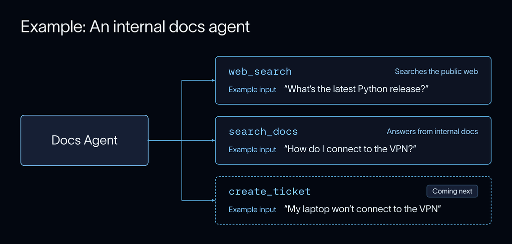
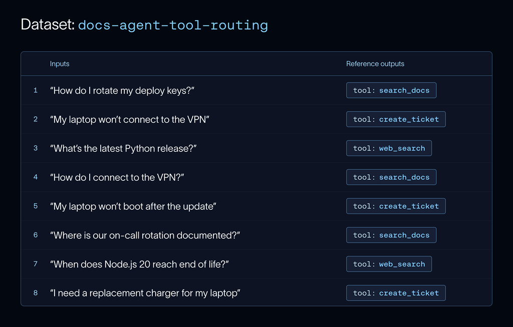
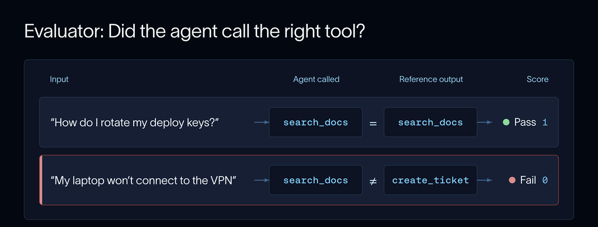
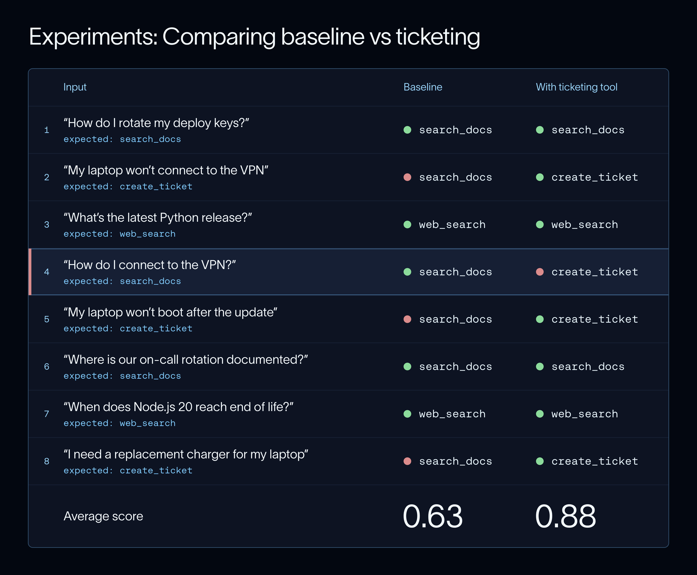
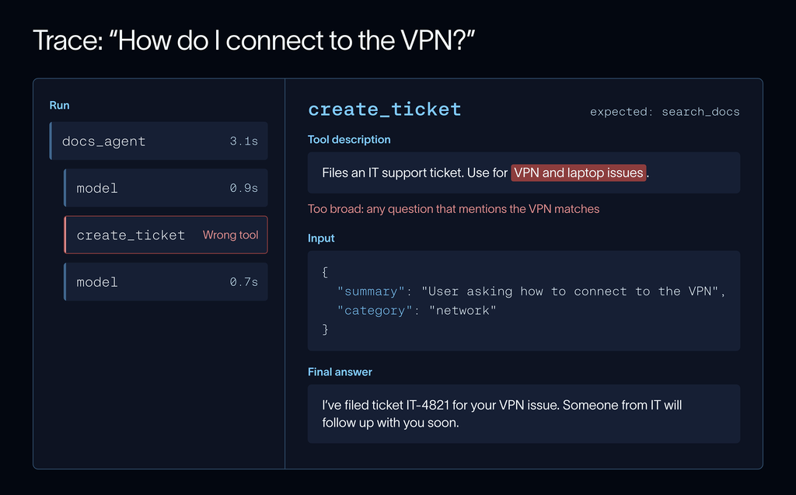
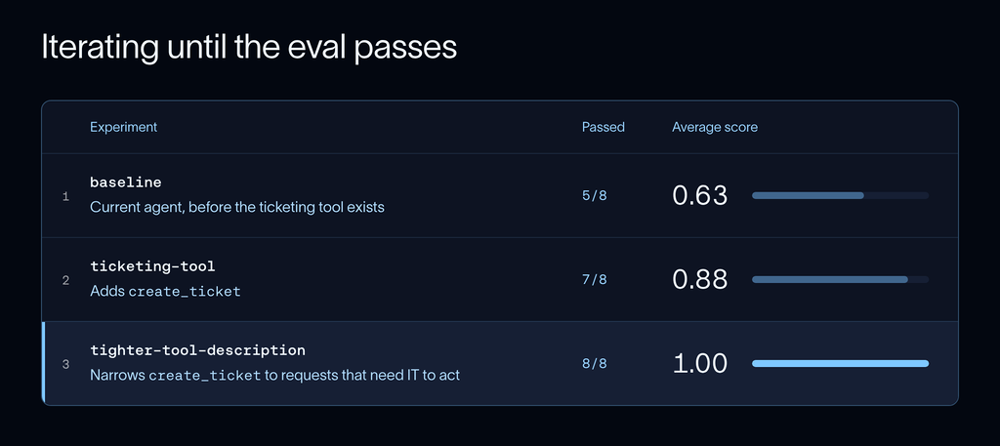

# 原文翻译：What Is Eval-Driven Development? How to Improve AI Agents（什么是评测驱动开发？）

> **原文标题**：What Is Eval-Driven Development? How to Improve AI Agents
> **作者**：Divya Santhanam
> **发布**：LangChain Blog，2026 年 11 月 9 日，阅读时长 10 分钟
> **原文链接**：https://www.langchain.com/blog/what-is-eval-driven-development
> **栏目**：Observability & Evals · LangSmith
> **说明**：以下为全文逐段翻译，保留原文结构、小标题、图注与链接；术语首次出现时括注英文原词。文中配图取自原文，已下载到 `图片/eval-driven-development/`，可离线阅读。

---

## 核心要点（Key Takeaways）

- **评测驱动开发（eval-driven development，EDD）** 指在构建 agent 的同时，用一套**一致的指标**来衡量其表现，并朝着评测结果**爬山式改进（hill climbing）**。
- EDD 的第一步是为「你期望的行为」写一份**简短规格（spec）**：好是什么样。要写清 agent **不该**做什么，以及哪些东西**必须继续可用**。
- 迭代时，用**对比实验（comparisons）**来评判你对 agent 所做的每一处改动。**修好一个用例的改动，很可能弄坏另一个。**
- 让评测**持续跑在 CI 和线上**，并把发现的失败**转化成新的数据集样例**。

大多数 agent 的开发都是从同一条路开始的：写一段 prompt，手动试几个问题，调一调，再试。这在早期很有效——那时 agent 的错误一目了然，改进也肉眼可见。但随着时间推移，你会越来越难判断「最近这次改动」到底让 agent 变好了还是变坏了。

评测驱动开发（EDD）通过给你一套**一致的指标**来解决这个问题：用这套指标衡量 agent 的表现，并据此做出决策。在 LangChain，我们在构建自家最先进的那些 agent 时就使用 EDD（可以看看我们关于 IssueBench 的[博文](https://www.langchain.com/blog/issuebench-how-we-evaluate-engine)），并把它的做法归纳为三步：

- 定义你的 agent 的「好」长什么样。
- 在动手构建之前先写评测。
- 做出改动，然后做对比。

本文会逐步走完这个过程，让你的团队能把它用进自己的 agent 开发流程。

## 什么是评测驱动开发？（What is eval-driven development?）

EDD 的名字和概念借鉴自**测试驱动开发（test-driven development，TDD）**：先写一个会失败的测试，再写让测试通过的代码。agent 与传统代码的不同之处在于它是**非确定性的（non-deterministic）**：

- **输出会变**。同一个问题，每次运行都可能得到不同的回答。
- **不止一个答案是对的**。两条表述不同的自然语言结果，可能都算正确。
- **agent 自己选择步骤**。它可能调用了一个并不需要的工具，或跳过一个本该用的工具，却仍然给出了正确答案。

因此，agent 需要一种**不同类型的测试**。评测（eval）的做法是：在一组样例上给 agent 的每次运行**打分**，以此应对上述问题。评测比传统测试更灵活——你可以对 agent 运行的**任何一个侧面**打分，也可以用另一个 LLM 来打分（即 **LLM-as-a-judge**）。

在 EDD 里，与 TDD 类似，这些评测就成了你对「成功」的定义，而你的工作就是朝着它们把 agent 建出来。

## 第一步：定义你的 agent 的「好」长什么样（Step 1: Define what good looks like for your agent）

EDD 的第一步是定义你的 agent 应该做什么。然后，列出为达成目标它需要处理的行为。这些行为可能是：从知识库回答问题、代表用户执行某个动作，或者知道何时该追问一句。为每一个行为写下需求。合在一起，它们就构成了你这个 agent 的**产品需求文档（PRD）**。

EDD **一次只处理一个行为**。这样你就有了一个很窄的靶子可以爬坡，而不会让一处改动混淆另一处的效果。你选中的这个行为，通常来自你马上要做的某个功能，或者你在 agent 的历史运行中发现的某个失败。

在写代码之前，先定义一份简短的**规格（spec）**会很有帮助，它覆盖：

- 这个行为**应当何时发生**
- agent **应当做什么**
- agent **不应当做什么**
- PRD 里哪些行为**必须保持可用**

这份规格要**明确到足以判 pass / fail 的程度**。

假设我们有一个**内部文档 agent**，员工用它查询公司信息。它有两个工具：查内部文档的 `search_docs`，以及查其他一切的 `web_search`。我们计划新增一个 `create_ticket` 工具，让它能发 IT 工单。我们的规格是这样：

- **When（何时）**：用户报告某样东西坏了，例如「我的笔记本连不上 VPN」。
- **Do（要做）**：调用 `create_ticket`。
- **Don't（不要做）**：为「操作类问题」发工单，例如「我要怎么连上 VPN？」。
- **Keep intact（保持不变）**：`search_docs` 与 `web_search` 仍然能处理它们今天能处理的问题。

我们会**按照这几条来评测，即使 agent 目前还没有这个能力**。

*图注：当前文档 agent 的示例实现，以及我们计划新增的工单工具。每个工具都配了一个会触发它的示例输入。*

## 第二步：在动手构建之前先写评测（Step 2: Write the eval before you build）

**建一个数据集（dataset）。** 数据集是一组**测试用例**（称为 example）的集合，每个用例有**输入**，并可选地带有参考答案（称为「golden」输出）。最好的输入来源之一是**真实的 agent 运行记录**。用户会用你意想不到的措辞表达，他们的请求里包含你可能根本想不到去写的边界情况。**如果你的样例看起来像真实流量，那么在你评测上拿到好分数，就更可能意味着线上行为也真的好。** 在 LangSmith 里，你可以直接把真实的 agent 运行添加进数据集。如果你还没有任何运行记录，常见的替代做法是从零开始构造样例。

对我们的文档 agent 来说，**少量样例就足够起步**。在数据集里，我们会放入工单类请求，再加上那些仍应交给 `search_docs` 和 `web_search` 的问题，以便把现有行为也一并纳入考量。

*图注：每个 example 把一条输入问题与参考输出（agent 应该调用的工具）配对。*

你还可以**扩展数据集，覆盖它目前还没有的用例**。比如我们手上「愤怒用户」的样例不多。我们可以把已有样例交给一个 LLM，让它把这些消息改写成更生气的语气，然后检查 agent 是否仍然调用正确的工具。

**写一个评测器（evaluator）。** 有了数据集之后，你就可以把 PRD 里对「好」的定义变成测试或评测，用它给 agent 在你的样例上的表现打分。写评测器时，要选择最适合你这个测试的**打分方式**：当检查是**确定性的**，用**代码评测（code eval）**；当不是，用 **LLM-as-a-judge**。你还要决定：要看 agent 的**最终回答**，还是看它为了走到那一步所**执行的某个动作**，或者别的什么东西？对我们的文档 agent 来说，我们要看它**调用了哪些工具**，以确认它在每种情况下都用对了工具。工具选择很容易用代码检查，所以我们用一个**代码评测**来检查每条样例是否调用了其参考输出所写的工具。

*图注：只要 agent 调用了其参考输出里的那个工具，该样例就算通过。*

我们的文档 agent 只是一个带几个特定功能的简单 chatbot。当你的 agent 越来越复杂时，你的评测套件**很可能需要换一种形态**。如果你的 agent 会在某个环境中**做出改变**（例如沙箱里的编码 agent），那么只检查几次工具调用和最终回复是**不够**的。你需要检查 agent 在系统里**留下的状态**，而且每次运行都需要一个**干净的环境**，以免一次运行影响下一次。**Harbor** 是一个开源框架，用来在这类任务上运行 agent，它也是 Terminal-Bench 这类行业基准背后的 harness。每个任务跑在各自的沙箱里，并附带一个给最终状态打分的测试脚本。

针对 Terminal-Bench 这类基准做优化，遵循的是与 EDD **同一个循环**：先写任务和测试，跑一个基线，然后在改动 agent 时对比实验。我们在构建 LangSmith Engine 时，就用真实的与合成的 agent 运行记录做了一个自己的基准，并把它作为 Harbor 评测来跑。我们也用 Harbor 来给 Deep Agents 做基准：它告诉我们，能否砍掉 harness 的某些部分——比如待办清单中间件（todo-list middleware）或系统提示的一部分——而**不让 agent 变差**。

**跑一个基线（baseline）。** 无论你如何构建数据集或评测器，你都可以让你的 agent 跑一遍**所有样例**，并把结果作为一次**实验（experiment）**记录在 LangSmith 里。一次实验就是对数据集的一次完整运行，其中每个样例的输入、输出和评测得分都被保存在同一条记录里。有一个**中心化的系统**，你才能把不同 agent 版本的结果互相比较。在对 agent 做任何改动之前，先跑一个基线实验作为对比基准，这一点很重要。

在我们的文档 agent 上，数据集里的工单类样例会得到**失败**的分数，因为这个工具还不存在。其他样例则记录下**当前已经工作**的部分，这样以后你就能看出：新增一个工具是否弄坏了别的东西。

## 第三步：做出改动，然后做对比（Step 3: Make your change and compare）

现在，我们实现 `create_ticket` 工具，并跑同一个评测。

记住，EDD 是一个朝着评测**爬山（hill-climbing）**的过程。爬山意味着重复「评测—对比—调整」这个改进 agent 的循环，从而建立一个**有客观改进证据**的固定回路。对 agent 的每一次后续改动都会得到它自己的实验，而每次实验都会与上一次对比，以验证是否进步。在 LangSmith 里，你可以选中两个实验打开**对比视图（comparison view）**，它会并排展示每个样例的分数，让你看清哪些样例变好了、哪些**回退（regressed）**了。

做实验对比时，重要的是不仅要关注**平均分的变化**，还要关注**任何回退**，以及**对已有可用行为的覆盖**。在我们的文档 agent 上，工单类样例现在通过了。但是「我要怎么连上 VPN？」现在会**发工单**，而不是去查文档。**平均分涨了，但有一个用例坏了。**

*图注：加上工单工具提高了平均分，但「我要怎么连上 VPN？」现在失败了。*

**查看 trace 是理解「评测为什么失败」的最好方式。** trace 是一次 agent 运行的记录，包含每一次模型调用和工具调用。只要是用你所选框架构建的 agent，都可以在 LangSmith 里做追踪。更多信息请看我们的 [tracing 快速上手](https://docs.langchain.com/langsmith/observability-quickstart)。

当我们打开最新实验里那条失败的 trace，我们看到：工具描述里写着用 `create_ticket` 处理「VPN and laptop issues（VPN 与笔记本问题）」，于是**任何提到 VPN 的问题都会匹配**。这就覆盖掉了基线上原本良好的行为。

*图注：trace 告诉我们，工具描述太宽泛，于是 agent 为一个文档本可回答的问题发了工单。*

解决方案是**把工具描述收窄**到「需要 IT 出手」的请求。实现这个改动后，我们再次运行评测。现在，**每一个样例都通过了**。

*图注：更严格的工具描述让每一个样例都通过。*

在**小数据集上拿到满分**是个好迹象，但 **100% 并不总是正确的目标**。我们是在盯着这些具体样例的情况下调工具描述的。如果你一直调整 agent，直到每个样例都通过，它可能开始**过拟合（overfitting）**你的数据集，而不是你以为的那个行为。它会通过你的评测，却依旧漏掉那些你样例没覆盖到的措辞。要检查这一点，请保留一份**留出集（held-out set）**，在你迭代时**不要去看它**。如果你调优用的样例分数上升、而留出集的分数**持平**，那你很可能正在过拟合。

多步 agent 可能在**任何一步**失败，所以 LangSmith 允许你评测的不只是最终回答：你可以给**单个步骤**打分，给**完整的工具调用序列**打分，或者给**按 thread 归组的多轮对话**打分。

## 在你持续交付过程中让 EDD 保持运行（Keep EDD running as you ship）

### 把你的评测自动化（Automating your evals）

当你越来越快地部署改动时，很容易就**跳过评测**，或者**跟丢旧的样例**。把自动化评测加进你的工作流，你就能阻止未经测试的改动进入用户手里，并在**上线前**抓住回退。

打造评测套件的最佳策略取决于你的具体环境。**快速的代码检查**可以拦住一次糟糕的合并；而**较慢的、带 LLM 裁判的评测**可以每天夜里跑，或在发版前跑。用**数据集切分（dataset splits）**在迭代时只跑你正在处理的那个行为的样例，然后在发布前跑**全量**。

LangSmith 与 **pytest** 和 **Vitest** 集成，因此你的评测可以就放在代码旁边，每次提交 PR 时都跑。每次运行都会记录为一次实验，你可以在同一个地方查看所有结果。

### 在生产环境中评测（Evaluating in production）

在部署 agent 之前，你的数据集很可能只覆盖了你在开发时**想到要测**的那些情况。上线后，你可以用下面这些评测手段把其余情况**标出来（flag）**：

- **在线评测器（Online evaluators）** 会在线上 trace 进来时为其打分。你可以把代码检查和 LLM 裁判挂到一个 tracing 项目上，并**采样一部分流量**以控制成本。
- **标注队列（Annotation queues）** 让你的团队人工复核被标记的运行。它也是你**在依赖某个 LLM 裁判之前，用来确认它与人类判断一致**的方式。
- **仪表盘（Dashboards）** 可以长期跟踪评测分数、反馈、成本与延迟，让你看清一次发布到底把事情变好了还是变坏了。
- **Insights** 会把生产环境的 trace **聚成簇**，让你能在成千上万次运行中看出新的模式。
- **LangSmith Engine** 更进一步，它把这些问题簇**直接变成数据集样例**（附断言）供你复核。

我们也把用于 Deep Agents 的评测发布在了它的仓库里[^1]，你可以看到一个真实的、生产级的评测套件。

[^1]: 原文链接：https://github.com/langchain-ai/deepagents/tree/main/libs/evals

## 常见错误（Common mistakes）

- **把成功定义得太含糊。** 前期多下功夫，把成功明确定义出来，评测才能轻易判 pass / fail。「回答是有帮助的」**不是一个定义良好的指标**。
- **在修好之后才写评测。** 一旦你看到了新输出，就很容易写出一个**注定会通过**的评测。先写它，并**确认它在当前这个坏的版本上确实失败**。
- **只看平均分。** 平均分的提升可能掩盖了某些样例的**回退**，或某些**覆盖掉好行为**的改动。决定是否保留一处改动之前，**逐条复核样例**。
- **加了并不需要的评测。** 每一个评测都会把 agent 往某个方向**推**。把每个评测都绑定到一个具体改动上——你正在修的一个失败，或你即将构建的一个功能。
- **信任未经检查的裁判。** 先把你用的 LLM 裁判与人类打分做对比。问它**窄**的问题，并用 **pass / fail**，而不是含糊的 1 到 10 分。

关于构建 agent 评测的更多信息，可以看这期关于 Agent Evals 101 的[网络研讨会](https://langchain.ondemand.goldcast.io/on-demand/762756f4-4344-4760-b4b9-a07dd63e76af)，以及我们免费的 LangChain Academy 课程[^2]。

[^2]: 课程链接：https://academy.langchain.com/courses/quickstart-langsmith-essentials

## 延伸阅读（Further reading）

- [The most common questions about agent evals, answered](https://www.langchain.com/blog/common-questions-about-agent-evals)（关于 agent 评测最常见的那些问题，附解答）
- [How we build evals for Deep Agents](https://www.langchain.com/blog/how-we-build-evals-for-deep-agents)（我们如何为 Deep Agents 构建评测）
- [Towards automating eval engineering](https://www.langchain.com/blog/towards-automating-eval-engineering)（走向自动化的评测工程）
- [LangSmith evaluation quickstart](https://docs.langchain.com/langsmith/evaluation-quickstart)（LangSmith 评测快速上手）

---

### 相关内容（Related content，原文页面自动推荐）

- **LangSmith BYOC is now available on AWS, Azure, and Google Cloud**（LangSmith BYOC 现已支持 AWS、Azure 与 Google Cloud）
- **The Most Common Questions About Agent Evals, Answered**（关于 agent 评测最常见的问题，附解答）
- **Search agent traces by behavior with AI Search in LangSmith**（在 LangSmith 中用 AI 搜索按行为检索 agent trace）

> 备注：原文页面的「Related content」是**轮换推荐**，每次打开可能不同；此处记录的是本次抓取时的三篇。
